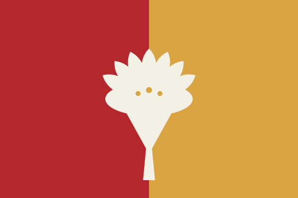
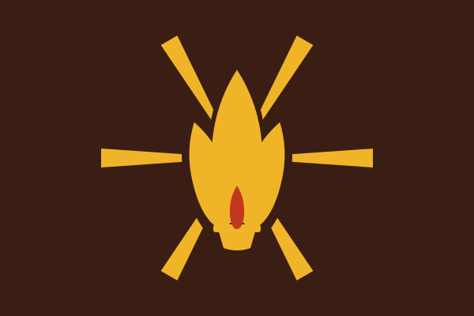

## 引言

提瓦特的国家体系在近代经历了一次深刻的重组。七国之间从零散的往来，逐渐变成有常设机构、有成文条约、有固定外交礼仪的体系：提瓦特国际联盟 (ILT) 的会场里，代表按国名首字母列席；提瓦特财团联盟 (TFC) 的议席上，各国以出资份额换取话语权；提瓦特虚空联盟 (TAA) 的技术标准文件需要各成员国的国家编号；铁路、航空与海运的跨境协定则把国旗印在列车、机翼与船尾。国家象征不再只是宫廷纹章，而是要在条约签字页、港口旗杆、护照扉页与列车车头上被反复辨认的公共符号。

在这套体系中，旗帜与徽记承担着两种不同的职能。旗帜是「远看的身份」：它在风中飘动、在缩小的照片里、在列队的外交场合中被一眼认出，因此必须简单、对称、可缩放。徽记是「近看的身份」：它出现在政府建筑的墙面、国书的封面、护照与货币上，允许承载更多层次——盾形、环带、冠饰与主纹章。两者共享同一套母题与色彩，才构成一个国家的完整视觉形象。

本志记录七国及至冬治下挪德卡莱自治地区、以及稻妻群岛内三个政治实体的旗帜与徽记，逐一说明其形制、释义与使用规则。它不是设计手册，而是一部「国家象征的考据」：每面旗、每枚徽的每一块颜色与每一道曲线，都应当能在各国的历史、政体与地理中找到出处；凡属本次新拟的内容（如部分国家的格言），文中均加注说明。

## 总则

### 旗帜学的五条原则

各国的旗帜设计虽然风格迥异，但都受到同一套朴素规则的约束，这套规则在提瓦特被称作「旗之五律」：

**其一，简。**旗面图形必须能在一瞥之间读完。七国中没有一面旗使用超过三种彩色，没有一面旗使用渐变、阴影或描边——旗帜是织物，远看时任何细腻的过渡都会丢失。风车菊的五瓣、三巴纹的三旋、圣火的六道放射，都是在这个限制下被提炼出来的。

**其二，有意义。**旗面不是装饰画。米白之于蒙德是雪与自由，紫之于稻妻是雷与王权，深褐之于纳塔是被火烤过的土地。凡不能说明来历的元素，一律不用。

**其三，三色为限。**基本色不超过三种（白色不计入，因其为底色），以保证在灰阶印刷、单色刺绣与褪色长旗上仍能保持结构。

**其四，不着一字。**七国旗帜上没有文字。国名、格言与年份不绣上旗面——这是旗帜学最古老也最容易被违反的规则：字在风中会碎，在缩略时会糊。

**其五，不与人同。**每面旗都要能在同时悬挂七面旗的场合中一眼区分。本志在分国志中为每个主体注明其与邻国的识别差异。

### 纹章学的结构规则

国徽与国家旗不同：旗是平铺的色块，徽是需要被「读」的图形。本志所录的国徽沿用提瓦特通行的三层结构：

**外框。**盾形或圆形。盾形承自中世纪骑士的盾面，圆形承自教会与行会的印章传统。七国中，蒙德、须弥、枫丹、至冬、挪德卡莱用盾形，璃月、稻妻、纳塔、海祇岛、清籁岛用圆形——这一分界大致对应「大陆国家」与「岛屿及东方国家」的纹章传统。

**主纹章。**盾心或圆心的那一个图形，通常是国家最核心的象征：蒙德的风车菊、璃月的岩晶、稻妻的三巴、纳塔的圣火、至冬的火炬。它必须单独也立得住，因为国徽常被拆开只用主纹章。

**环带与冠饰。**环带是外框内沿的带状区域，本志十枚国徽的环带一律填充该国传统几何纹样（风纹、回纹、雷纹、浪纹、齿纹、叶纹、菱格、火纹、月牙纹、冰裂纹），而**不刻文字**——这是本志的一以贯之的取舍：格言属于国书与宪法序言，国徽只负责图形。冠饰（风星、浪冠、冰晶冠等）只加在盾形徽上，圆形徽不设冠饰，以此保持「盾徽有冠、圆徽无冠」的结构区分。

纹章学还有一条几乎从未被打破的层色法：金属色（金、银）不与金属色相邻，彩色不与彩色相邻——否则远看会糊成一片。本志十枚国徽均遵守此律，唯一的「例外」是橙与金这类相邻色，已在各自释义中说明处理方式。

### 元素色板与色彩纪律

提瓦特七元素各有其约定俗成的色相：风为青绿、岩为琥珀、雷为紫、草为绿、水为蓝、火为橙红、冰为浅蓝。这个色相体系是各国旗徽配色的共同底本，但没有任何一面旗直接把元素色原样搬上旗面：各国都按本国的地理与历史做了偏移。

蒙德把风元素色压向深青，以贴近星落平原的冷色调；璃月把岩元素色压向赭金，以贴近璃月的岩层与摩拉，再以一道桃花粉点缀；稻妻把雷元素色压向深紫，褪去亮度以显王权的沉；须弥以革命红压沙金，红取社会主义革命的政党色、沙金取沙漠的地色；枫丹的水色偏蓝灰，不属于热带海的翠，而属于北方水城的冷；纳塔的火色偏暗褐，因为旗帜上的红是「烤过的火」而非跳动的焰；挪德卡莱的月色是被永夜滤过的银蓝；至冬的冰蓝则被晶金点燃。

这一层偏移不是任意的：它让七国旗帜在并置时既有共同的「提瓦特感」，又各自可辨。

### 构图谱系

十面旗帜的构图可归为六类：

- **横带式**：旗面以水平色带分割（蒙德、枫丹、至冬）；
- **纵分式**：旗面以垂直色带分割（璃月）；
- **中央徽记式**：单一底色上置一枚居中的徽记（稻妻、纳塔）；
- **边带式**：以旗杆侧竖条为特征（清籁岛）；
- **圆环式**：以同心圆环为结构（海祇岛）；
- **月相式**：以非对称的月相排列为结构（挪德卡莱）。

须弥的左右双元分割可视为纵分式的变体。六类构图的分配本身携带信息：越接近「中央徽记式」的旗帜，越强调单一中心的权威；越接近「分割式」的旗帜，越强调多元与制衡。这一观察在第三章展开。

### 法理现状

七国中只有蒙德把国旗国徽写入宪法：《蒙德联邦宪法》第四十一条规定「国旗、国徽式样由联邦法律规定」。其余国家的宪法或基本法未设专条，国家象征以惯例法与政府法令为准：璃月的《国家象征条例》、须弥的《联邦旗帜徽记办法》、枫丹的《共和国象征令》、纳塔的《圣火盟约》附款、至冬的《皇都评议会敕令》、稻妻的《幕府仪典则例》，均非宪法层级。

值得注意的是，清籁岛与挪德卡莱这两个政权的旗徽：清籁岛的旗帜由工农革命党第一次代表大会决定，其法理基础是革命本身；挪德卡莱联合政府的旗帜则由十一股势力共同议定，其地位写在一份没有宪法效力的《联合政府章程》里——这恰恰是两地政治现实在纹章上的投影。

### 编纂体例

分国志按「大陆国家（蒙德、璃月、须弥、枫丹、纳塔）—东方与北方（稻妻及三实体、至冬、挪德卡莱）」的顺序排列。每个主体依次说明：法定地位与使用、旗帜释义、徽记释义、设计沿革与辨识度、与既有文本的衔接。释义统一使用「部位—图形—色彩—象征」四栏表；色彩给出十六进制值，便于复现。

### 画布与设计网格

国旗的标准画布为 3000×2000（三比二），国徽为 2000×2000（一比一，内容居中、四周留边）；页面内显示尺寸分别为 600×400 与 300×300。为便于对照，本志释义与几何说明中的坐标、半径与模数统一以 600×400（旗）与 400×440（徽）的**设计网格**计——SVG 文件即该网格的 5 倍（旗）与约 4.545 倍（徽）等比铺设，故文中的网格数值可直接对应文件中的原始坐标。

## 分国志

### 蒙德自由合众国

#### 法定地位与使用

蒙德的国旗与国徽依《蒙德联邦宪法》第四十一条设立——「国旗、国徽式样由联邦法律规定」。联邦据此于建国后不久制定《国家象征法》，规定联邦议会开幕、风神节、国家元首就任、以及外国元首来访时升挂国旗的次序；国徽用于联邦机关、驻外使领馆、西风骑士团的军旗与军舰旗，以及联邦铁路与国有航空器。联邦制下各领保留领地旗，但联邦旗在领地内享有优先地位。国旗与国徽均不得用于商业标识；商业团体可采用经批准的变体，如「狮牙快线」在车体与票务宣传中所用的简化徽。

#### 国旗释义

旗面以米白为底。在蒙德的色彩传统里，白既是星落平原的雪，也是「尚未被权力涂改的空白」——自由宣言所许诺的那片空地。上下两道等宽的风青绿边带分居旗面两端：上带喻天空与风，下带喻草原与土地；两条带子夹住中间的大片留白，正是国家格言「自由高于一切，秩序守护自由」的视觉表达——自由居于中央，秩序在两侧托住它而不侵入它。

旗面比例三比二，边带各占旗高百分之十四，中央徽记只留一朵风车菊。风车菊是蒙德的国家象征之一，《蒙德经济与产业概况》记其鲜花与干花制品「在国际市场具有极高的品牌辨识度」；《蒙德电力概况》则把星落平原的风机群称为「最深入人心的国家象征」。设计把这两种象征合成一个图形：花取五瓣，瓣形一侧鼓起、一侧内收，顺时针旋转七二度错位排列，使静止的花朵呈现出风车在风中旋开的动势。花心为深墨绿圆点，缀一枚白色小圆，如花蕊亦如日轮；直径取旗高百分之五十二，保证在旗杆上、在十六像素的缩略图里都读得出来。

| 部位 | 图形 | 色彩 | 象征 |
|:---:|:---|:---:|:---|
| 旗面 | 米白底 | `#F4F7F5` | 雪原、自由宣言许诺的空地 |
| 上下边带 | 等宽横带（各占旗高 14%） | `#4FBFA0` 风青绿 | 天空与风（上）、草原与土地（下）；秩序托住自由 |
| 中央徽记 | 五瓣风车菊 | `#D8A93C` 金 | 国花与清洁能源之国；金的麦色呼应星落平原 |
| 花心 | 圆点 | `#1E3A31` 深墨绿 + 白点 | 骑士团的墨绿；白点取「风神之眼」意象 |
| 比例 | 三比二；边带 56 / 旗高 400 | — | 简洁、远观可辨 |

#### 国徽释义

国徽为盾徽，形制承自西风骑士团早期的盾形纹章，此后由联邦接手为国家徽。整体三层：最外为金色盾边，取骑士团鎏金；内为深墨绿环带，环带内侧另描一道细金线，使「自由」与「秩序」之间留出一条可见的边界；盾心为米白，与旗面同色。盾顶不再加冠，只置一枚四角风星——取自由宣言颁行之日晨星当空的意象，也指代风神；风星两侧各三道风纹自盾顶向外上方扬起，构成一对抽象的风之翼，既呼应西风骑士团「风之翼」滑翔翼部队，也呼应国歌《自由之风永远吹拂》。盾心中央仍是那朵风车菊，但改为青色花瓣、金色花心，与国旗上的金瓣墨心互为反相——国旗是「风中的花」，国徽是「花中的风」。

国徽不设铭文，格言见于宪法序言与国书——骑士团的盾上从不写字，誓言由持盾的人说出口。

| 部位 | 图形 | 色彩 | 象征 |
|:---:|:---|:---:|:---|
| 盾边 | 双弧肩、圆底收尖的盾形外沿 | `#D8A93C` 金 | 骑士团鎏金；联邦的法定边界 |
| 环带 | 内沿环带 + 细金分界 | `#1E3A31` 深墨绿 | 风与森林；西风骑士团 |
| 盾心 | 盾形内区 | `#F4F7F5` 米白 | 雪原与自由 |
| 冠饰 | 四角风星 | `#D8A93C` 金 | 自由宣言的晨星、风神 |
| 冠饰 | 六道风纹（左右各三） | `#4FBFA0` 风青绿 | 风之翼；国歌中的「自由之风」 |
| 主纹章 | 青色风车菊 + 金心 | `#4FBFA0` / `#D8A93C` | 与国旗同源，反相处理 |

#### 设计沿革与辨识度

TE 1000 年九月一日《自由宣言》颁布后，蒙德以一面仅绘单朵风车菊的白旗为临时国旗（本志所称「宣言旗」）。共和初期制定《国家象征法》时，议会为「要不要给旗面加边」争论许久：一派认为留白即是自由，加边便是限制；另一派主张旗在风中需要压边才不至于辨认困难。最终妥协为上下各一道窄边，中央留白——这就是今天旗面的由来。（以上沿革为本次新设定，与《蒙德综述》所记国庆日「TE 1000 年 9 月 1 日（自由宣言颁布日）」衔接。）

辨识度测试：缩至十六像素时，青绿边带与金色花辨仍可分；纯黑与纯白单色版中，风车菊以实心剪影呈现，花心镂空，仍可辨为五瓣；夜间深色旗面下，米白盾心与金色风星对比充分。与邻国旗帜并置时，蒙德的青绿—白—金组合在大陆诸国中独一无二。

#### 与既有文本的衔接

- 《蒙德铁路概况》记 MR 160 J 动车组「涂装：墨绿底色配金色风车菊纹饰，车头印有蒙德国徽及『狮牙快线』品牌标识」。国徽在车头采用单色反白版：墨绿车体上以金色线描呈现盾形与风星，风车菊退为底纹——与本志「单色版」规则一致。
- 国旗的上下边带与国歌《自由之风永远吹拂》同源；国徽的风星与国庆日所记「自由宣言颁布日」同源。
- 国徽不设铭文，格言「自由高于一切，秩序守护自由」见于宪法序言与国书。

### 璃月共和国

#### 法定地位与使用

璃月共和国行总理内阁制的议会民主制，国家主席为虚位元首，政务院总理掌行政实权（《璃月综述》：「**政体**：总理内阁制的议会民主制。[璃月人民党](../../璃月/璃月政治概况.md)长期执政，形成「一党主导、多党竞争」格局。」）。国旗以共和国名义统辖，用于政务院及所属各部、驻外使领机构、人民军与宪兵部队、国资委全资企业总部等场合；商船悬挂国旗时不得另加任何图记，党争不入旗面。最集中的用旗日是国庆日送仙典仪日——《璃月综述》记：「**国庆日**：送仙典仪日（定于帝君让权之日，以志还政于民之义）。」

#### 国旗释义

旗面先作左右纵分：左半米白、右半琥珀金，一条粉红窄边带横贯顶上，中线上压一枚六棱岩晶。整体情绪取「稳重、克制、几何化」——没有一个曲线，没有一处描边，全部由面的分割构成。

左半米白是契约之纸。璃月以契约立国，《璃月综述》载国家格言「契约既定，万世不移」，旗面左半留白即未书之约、待定之契；米白又是璃月的纸色，故此处不画任何纹样，留白本身就是内容。右半琥珀金是岩与摩拉：琥珀金为璃月主色，整幅取金，与左半的留白形成「一半写下的约，一半兑现约的力」的对分。顶部粉红窄边带高 36 单位、横贯全宽，压在岩层断面之上——取桃汛时天衡山脊的桃花与琉璃色，是旗面上唯一的暖色横带。中线处跨分割线的六棱岩晶是旗心：正六边形、顶点朝上，外接圆半径 104，自外而内三层同心——墨色外层为「岩」，赭石中层为「矿脉」，粉红晶心为「晶心」。旗面彩色只有琥珀金、赭石、粉红三种；墨为线色、米白为纸色，均不计入三色，合旗帜学「基本色≤3」之限。

| 部位 | 图形 | 色彩 (HEX) | 象征 |
|:---:|:---|:---:|:---|
| 左半旗面 | 竖直矩形 300×400 | 米白 `#F5EFE3` | 契约之纸、待定之约 |
| 右半旗面 | 竖直矩形 300×400 | 琥珀金 `#E0A94A` | 岩与摩拉，国富之源 |
| 上边带 | 横贯矩形 600×36 | 粉红 `#E79AA6` | 桃汛桃花与琉璃色，压在岩层断面上 |
| 岩晶外层 | 正六棱（尖顶）外接圆 R=104 | 墨 `#2B2118` | 岩 |
| 岩晶中层 | 正六棱 R=62 | 赭石 `#8A5A2B` | 矿脉 |
| 岩晶心 | 正六棱 R=26 | 粉红 `#E79AA6` | 晶心，桃色一点 |

几何说明（设计网格 600×400，SVG 画布为其 5 倍即 3000×2000）：以 20 单位为模数；中线 x=300 把旗面作 1:1 纵分；上边带高 36（占旗高 9%）。岩晶心在 (300,218)，外接圆 R=104，高 208（占旗高 52%）、宽 √3×104≈180（占旗宽 30%）；三层半径比为 104:62:26，约合 4:2.4:1。六棱的六顶点分别落在 0°/60°/120°/180°/240°/300° 六个精确角上，无渐变、无描边。岩晶跨中线而立，左右各露一角，是「契约」与「岩」两块旗面唯一的连接件。

#### 国徽释义

国徽为圆徽（岩晶环），外径 300。三层结构：琥珀金外圈 → 墨色环带（内织十六组回折纹）→ 米白内盘与中央六棱岩晶。

外圈是琥珀金圆环，外径 300(r=150)、环宽 8，作金属收边。环带为墨色圆环，r=116 至 142；环带内以琥珀金织出十六组连续方折回纹，径向占 120 至 138、纹线宽 5，每组按 15° 等分相接，一眼看去是一条不断头的折线环——取契约条款连绵、回环不移之意。内盘为米白 r=113.5，与环带之间以 2.5 宽的金色细环分隔，符合纹章学「环带与主纹章之间以细线分隔」的层色法。主纹章是中央六棱岩晶：墨色外沿 R=94 勾出晶边，琥珀金晶面 R=88，内套赭石矿脉层 R=56，正中一方墨色岩核 R=26，中央母题直径 188，占外框内切圆的 63%，正落在规范要求的 55%~70% 区间。徽心与回折纹环合观，即《璃月汽车动力技术》车牌章节所称的「岩晶纹」。国徽不设冠饰，也不使用任何文字：帝君已让权，纹章只以环收束，不再以冠加冕。

| 部位 | 图形 | 色彩 (HEX) | 象征 |
|:---:|:---|:---:|:---|
| 外框 | 圆环，外径 300、环宽 8 | 琥珀金 `#E0A94A` | 金，国体之表 |
| 环带 | 墨色圆环 r=116~142 | 墨 `#2B2118` | 铁墨，法度 |
| 回折纹 | 十六组连续方折纹，径向 120~138 | 琥珀金 `#E0A94A` | 契约条款，回环不移 |
| 内盘 | 圆 r=113.5 | 米白 `#F5EFE3` | 纸，约文之底 |
| 岩晶外沿 | 正六棱 R=94 | 墨 `#2B2118` | 岩 |
| 岩晶面 | 正六棱 R=88 | 琥珀金 `#E0A94A` | 晶面 |
| 岩晶内层 | 正六棱 R=56 | 赭石 `#8A5A2B` | 矿脉 |
| 岩核 | 正六棱 R=26 | 墨 `#2B2118` | 岩核，地脉之根 |

几何说明：`viewBox` 400×440，徽心 (200,220)，以 10 单位为模数；外径 300，环带 26 宽；岩晶四层半径 94 / 88 / 56 / 26，六棱顶点同在 15° 的整数倍方向上；回折纹每组由两条径向短划与两条切向短划首尾相接，全部以「面」的拼合完成，未使用任何描边表达结构。

#### 设计沿革与辨识度

以下沿革为本次新设定，仅「引号内」为既有文档原句。

TE 2005 年共和国成立当年，制宪会议同时议定旗徽。初版国旗已取「半纸半金」的纵分，国徽只作单层六棱岩晶，环带尚是素面。TE 2008 年，交通主管部门统一机动车号牌制式，国徽被定为「岩晶纹」并压印在号牌左侧的琥珀金竖条上（《璃月汽车动力技术》：「**琥珀金条**：压印璃月国徽与国际码 `LY`。」），自此岩晶纹从纹章变成了一枚工业标记，必须具备缩小到十几毫米仍可辨认的骨相。TE 2018 年前后定稿现行版式：环带补入十六组回折纹，岩晶确立「岩—脉—心」三层；国旗随之把岩晶做成同样的三层同心，使「旗徽同源」落在同一条六棱骨架上。

辨识度测试按两道关口做：一是缩至 120 像素宽（约合 16 像素图标的四倍信息量）时，纵分线、上边带与六棱外轮廓仍清晰，琥珀金晶心不失；二是单色墨稿时，岩晶可仅凭外轮廓与三层递收的台阶成立，不依赖色彩。夜间与低照度场景下，琥珀金与米白的明度差足够，岩晶的墨色轮廓即旗面的定位点。

#### 与既有文本的衔接

- 《璃月汽车动力技术》车牌章：「| 左侧欧盟蓝条、国旗星标与国别码 | 左侧琥珀金竖条、璃月国徽（岩晶纹）与国际码 `LY` |」；同章又记「**岩晶微纹**：反光层内嵌地脉岩晶微图案，侧光下可见璃月国徽暗纹。」本设计的六棱三层岩晶即「岩晶纹」的最小可复现形态：外沿、晶面、内层、岩核四圈，缩到 12 毫米见方仍留得下三圈层次，正合压印与暗纹两道工艺。
- 《璃月综述》「**国家格言**：契约既定，万世不移。」→ 左半留白（未书之约）与国徽回折纹环（条款连绵、回环不移）两处呼应。
- 《璃月综述》「**国庆日**：送仙典仪日（定于帝君让权之日，以志还政于民之义）。」→ 国庆升旗为主用旗场合；国徽以「环」收束不设冠饰，正合「还政于民」之义。
- 《关于共和前后的若干历史问题的决议》：「帝君之『去』，并非遇刺，而是深思熟虑的让权——以『假死』退位，将璃月的命运交还给人间。」→ 岩晶居旗面正中而不居顶端，刻意不与天争高（本次新设定）。
- 《璃月政治概况》「璃月实行『一党主导、多党合作』」→ 旗徽均不载党派图记，只留契约与岩；党争在议会，不在旗上。

### 稻妻王国（幕府政权）

#### 法定地位与使用

稻妻王国是稻妻群岛三个政治实体中人口与经济体量最大的一个，政体为君主立宪制，《幕府综述》记「**政体**：君主立宪制。」，国名条作「**国名**：稻妻王国（幕府政权），通称幕府。」。同一部文献体系里还有第二套写法：《稻妻国宪法》第二十四条（国号）作「国号为稻妻国 (Kingdom of Inazuma)，对外以此名义参与外交事务；对内沿用「幕府」称谓」。《幕府政治概况》的注释则把两者并置，称「其正式国号为「稻妻王国」(Kingdom of Inazuma)」。本志取「稻妻王国」为旗帜与徽记的正式名称（与图片文件名一致），条文用语从宪法作「稻妻国」。

这面旗由幕府中央统一使用：议事厅、三奉行、幕府军与御神卫队，以及驻外机构。三个实体的对外代表权由幕府一家行使，《稻妻综述》记「三个政治实体在国际上的代表权由幕府统一行使，但海祇岛以观察员身份独立参与提瓦特财团联盟 (TFC)。」，同文对外关系节又记「幕府对外代表稻妻群岛整体行使外交权。」。因此在提瓦特的国际场合，紫金三巴旗就是「稻妻」的默认视觉代表；海祇岛自治领旗只在「稻妻·海祇岛」身份下出现，清籁岛人民政府旗则连这个身份都没有——幕府不承认其合法性。使用场合包括将军诞辰与即位纪念、议事厅会期开幕、军舰与御神卫队营区、国际条约签字。并悬时的旗序为：王国旗居中，自治领旗居左（本次新设定，沿《幕府与海祇岛和解备忘录》签署仪式的排法）。

#### 国旗释义

旗面为单色雷紫，正中一枚深紫圆轮，轮内嵌金色三巴纹。整体是一枚放大的家纹：稻妻的纹章传统不靠文字与写实图案立威，旗面只放三巴，不放文字与花饰。雷紫取自雷元素之国的主色，也是这个群岛最常见的天色；深紫圆轮取「幕」字本义——将帅出征所设的帐幕，抽象为正圆，指幕府政权本身笼罩诸岛，同时它也是夜里的月轮，为中央金纹作底（本次新设定）。三巴纹是日本家纹的经典母题，三个逗号形旋涡首尾相衔、同向逆时针甩尾。在稻妻的解释里，三个旋涡头对应三奉行——社奉行神里家、天领奉行九条家、勘定奉行柊家（《幕府综述》「实际权力中枢为**三奉行**：社奉行（神里家，管文化宗教）、天领奉行（九条家，管军事治安）、勘定奉行（柊家，管财政经济）。」），三头共绕一个圆心，即三奉行同向环转、共奉一主；旋涡持续同向回旋而不散，正是将军口中「永恒」的图形化。金色既是雷光，也是稻妻赖以立国的金属工艺——半导体与集成电路的精密微雕蚀，《幕府综述》记「依托雷元素精密微雕刻蚀技术，**半导体与集成电路**为核心产业」。

| 部位 | 图形 | 色彩 (HEX) | 象征 |
|:---:|:---|:---:|:---|
| 旗面 | 通体平涂矩形 | 雷紫 `#6B4FA8` | 雷元素之国的天色；《稻妻综述》「稻妻文化深受雷元素信仰与武士道传统影响」 |
| 中央圆轮 | 正圆，半径 116 | 深紫 `#2E2144` | 「幕」为本义帐幕，抽象为轮，指幕府政权本身；亦作夜月 |
| 主纹章 | 三巴纹，外缘直径 200 | 金 `#C9A227` | 三奉行（神里、九条、柊）同向环转、共奉一主 |
| 旋涡头 | 三枚圆头，半径 20 | 金 `#C9A227` | 三奉行的家格与「三」之定数 |
| 旋涡尾 | 逆时针甩出 145° 的锥形尾 | 金 `#C9A227` | 「永恒」之循环：环转不散，周而复始 |

几何说明（设计网格 600×400，SVG 画布为 3000×2000）：元素距边 ≥24，旗心 (300,200)。圆轮 r=116，三巴外缘 R=100（直径 200，恰为旗宽的三分之一，与日章旗取「旗宽三分之一」的古典比例同法）。三个旋涡头的头心位于半径 44、相位 −90°/30°/150°，严格 120° 旋转对称；尾部自头心沿螺旋外甩 145°，全宽按 (1−t)^0.55 由 40 收束至尖；头部另加同径圆 r=20，使旋涡头保持家纹式的圆钝。图形不用描边，只作面的分割。

#### 国徽释义

国徽为家纹式圆徽，外径 300，圆徽之上加三峰神樱冠，全图无文字。结构自外而内三层：金外环 (r=150)；深紫雷纹带 (r=132)；雷紫圆章 (r=106)，章心为金三巴，外径 148，占内切圆约 70%。雷纹带用十六组尖角折线作一环锯齿，取「闪电折线」而非回纹式雷文——《稻妻综述》记「踏鞴砂的雷暴和御影炉心构成独特的地质奇观」，环带即一圈引而未发的雷。神樱冠取社奉行所掌，《幕府综述》记社奉行「管文化宗教」，而《幕府政治概况》记「八重神子：鸣神大社宫司，支持温和派路线。」——冠是给社奉行与鸣神大社留的位置，不是给将军本人的，所以冠上没有雷电纹、没有三巴。冠体深紫、镶金边、三峰；冠内三朵五瓣神樱，瓣月白、花心为金，三朵与三巴同构，让冠与章在数目上连成一气。国徽不设表意文字，格言与国书由文书承载，此为国家层面的统一取舍。

| 部位 | 图形 | 色彩 (HEX) | 象征 |
|:---:|:---|:---:|:---|
| 外环 | 圆环，外径 300、宽 18 | 金 `#C9A227` | 王权与雷光的金属圈 |
| 环带 | 十六组尖角折线，环宽 26 | 深紫 `#2E2144` 底、金折线 | 雷纹（闪电折线式）；踏鞴砂常年雷暴 |
| 主纹章区 | 正圆 r=106 | 雷紫 `#6B4FA8` | 与国旗同色同纹的圆章 |
| 三巴 | 外径 148 | 金 `#C9A227` | 三奉行；与国旗共用母题 |
| 冠体 | 三峰冠形，宽 144、高 108 | 深紫 `#2E2144`、金边 | 神樱冠；社奉行所掌的宗教与文化 |
| 神樱 | 五瓣花三朵（大 25、小 17） | 瓣月白 `#F2EEF7`、心金 `#C9A227` | 神樱；鸣神大社与稻妻神道 |

几何说明（设计网格 400×440，SVG 画布为 2000×2000、四周留边）：圆徽心 (200,266)，外径 300。环带 132→106 为 26，折线峰谷 r=128/113、描边 7，十六峰均布（22.5° 一峰）。冠底宽 144、冠峰最高点 y=32，冠体下缘压入圆徽金环之下，使冠「长」在徽上而非浮在徽上。

#### 设计沿革与辨识度

以下三个时点均为本次新设定，仅作为正文叙事骨架，日期不与既有大事记冲突（《稻妻大事记》在 TE 2002、2025 均有条目，此处只在条目之间补旗徽沿革）。

- **TE 2002 年**：锁国令松动、开放有限外贸窗口（《幕府综述》「TE 2002 年锁国令松动、开放有限外贸窗口后进入近代化改革期」），幕府需要在对外窗口挂一面不依赖文字的旗，遂取家纹三巴为底本，定雷紫底、金三巴，中央加深紫圆轮——从「家纹」升格为「国旗」，靠的正是那枚圆轮给的边框感。
- **TE 2005 年**：国徽定型。加雷纹带与神樱冠，理由不在美观：国徽要在三奉行各自的衙署、军舰舰艏与国际条约文本上同时出现，必须把「三奉行体制」本身画进去，故国徽不是国旗的放大，而是三奉行体制的展开。
- **TE 2025 年**：《幕府与海祇岛和解备忘录》签署（《稻妻综述》「TE 2025 年《幕府与海祇岛和解备忘录》签署，确立海祇岛自治领法律地位」），和解仪式上幕府旗与自治领旗并列，此后成为并悬惯例。

16 px 测试：圆轮与金色三巴缩到 16 px 时，旋涡尾部会糊成一个金点，故尾部宽度按 (1−t)^0.55 缓收而非直收，实测 16 px 下仍能看出三个头与旋转方向，旋转对称的图形在极小尺寸下保住了「动」的感觉。单色测试：以纯金单色印于雷紫之上可辨，圆轮改以深紫网点表示（见本志总纲）；夜间可辨性按明度估计——雷紫约 11.5、深紫约 2.1、金约 37，两两明度差均超过 30%。与清籁岛旗的区分：紫与红、圆轮与竖条加星、对称家纹与非中心构图，三者同时成立，缩到 16 px 也不会被认成同一面旗。

#### 与既有文本的衔接

- **国号双轨**：见本节开头。《幕府综述》「稻妻王国」、《稻妻国宪法》「稻妻国」、《幕府政治概况》注释「正式国号为「稻妻王国」(Kingdom of Inazuma)」三处并存，旗徽取「稻妻王国」，正文宜以一句注文交代，不必强行统一。
- **将军与国体**：《幕府政治概况》「**雷电将军**是稻妻国的象征性和实际权力的最高领袖。」「作为神圣象征，雷电将军在宗教事务中也拥有重要地位，是国家主要宗教活动的主持者。」——旗徽不画人形、不画神体，只以三巴与神樱冠指涉；这是稻妻纹章传统的边界，也是本志「国徽不用文字、不用人像」的总原则在稻妻的落点。
- **三奉行与「三」**：《幕府综述》三奉行名单已见前引；三巴三头、神樱三朵，两处「三」互为注脚。若正文需要解释「为什么是三个而不是四个」（幕府辖四岛），答案在制度而不在地理。

### 海祇岛自治领

#### 法定地位与使用

海祇岛自治领是稻妻国境内实行高度自治的地方政权，政体为议会制共和。《海祇岛综述》记「**政体**：议会制共和政体。」，法律地位条记「依据《幕府与海祇岛和解备忘录》，以高度自治身份重返稻妻国，拥有独立货币、财政体系与武装力量；对外事务享有高度自主权，但以「稻妻海祇岛」身份开展，签署国际条约前须向幕府中央政府备案（备忘录第八条）。」；《海祇岛基本法》第二条把政体写成一句更硬的话：「自治领实行议会制共和政体。议会是最高立法机构，执政长官是地区首脑，行政长官是政府首脑。」，第二十四条定首府「自治领首府为珊瑚宫镇。」。议会 153 席、普选、任期四年（基本法第十条）。

旗由自治领政府、议会与海祇岛自卫队使用，对外以「稻妻·海祇岛」身份出现（基本法第六条「须表明「稻妻·海祇岛」身份，并在签署前向稻妻国中央政府备案（依《幕府与海祇岛和解备忘录》第八条）」），并以观察员身份参加提瓦特财团联盟（《稻妻综述》「海祇岛以观察员身份独立参与提瓦特财团联盟 (TFC)」）。使用场合包括议会会期开幕、《海祇岛行政区划》所记的「珊瑚宫潮汐祭」、与幕府的双边磋商与备忘录周年仪式。这面旗与幕府旗并悬时居左，与清籁岛旗并悬时居右（本次新设定，按与中央的亲疏排序，而非按人口）。

#### 国旗释义

旗面海蓝，中央两道潮白浪环相套，环内一枚白色圆盘，盘中一枝粉红珊瑚：单主干向上，四条分枝向上弯曲，枝端各生一枚潮白球节。整体气质是「海」而不是「国」——海祇岛的合法性来源是海与珊瑚宫，旗面就把这两样放在最显眼的位置。海蓝取珊瑚礁海域之色，《海祇岛综述》记「周边海域拥有大面积珊瑚礁生态系统」；两道浪环一为潮汐、一为议会任期，两环同心而不相交，表示神权传统与民选权威在自治领体制里各据一层、彼此不吞并（本次新设定）。浪环的缘不是圆规画的圈，是余弦起伏的环缘，像海面而不是像徽章。中央白盘取珊瑚宫的白色宫墙与礁湖，也是「圣土」的颜色：《关于神权控股及其后果》记「全岛土地皆为海祇大御神的「圣土」」。珊瑚枝取珊瑚培育与珍珠养殖，《稻妻经济与产业概况》记「海祇岛水域的珍珠养殖和珊瑚培育产业历史悠久，所产珍珠在枫丹奢侈品市场和璃月高端珠宝市场享有盛誉」；四条分枝对应四大支柱产业（《海祇岛综述》「四大支柱产业：**海洋生物制药**（高端海洋药物、抗衰老医美原料）、**现代海洋产业**（深海网箱养殖、海洋生态监测、海藻化工、深海科考）、**特色高附加值农业**（热带经济作物、稀有药用植物）、**远洋渔业与水产加工**。」）；枝端球节是珊瑚虫，也是珍珠贝的珠核（本次新设定）。

| 部位 | 图形 | 色彩 (HEX) | 象征 |
|:---:|:---|:---:|:---|
| 旗面 | 通体平涂矩形 | 海蓝 `#1F6F8B` | 珊瑚礁海域；《海祇岛综述》「周边海域拥有大面积珊瑚礁生态系统」 |
| 外浪环 | 余弦起伏环，r 160/147，振幅 6，8 波 | 潮白 `#EFF6F8` | 潮汐；「珊瑚宫潮汐祭」 |
| 内浪环 | 余弦起伏环，r 128/117，振幅 4.5，12 波 | 潮白 `#EFF6F8` | 议会任期与民选权威（本次新设定） |
| 中央圆盘 | 正圆 r=102 | 潮白 `#EFF6F8` | 珊瑚宫白墙与礁湖；「圣土」之色 |
| 珊瑚主干 | 单主干，粗 19（本地单位） | 粉红 `#E88FA8` | 珊瑚培育与海洋生态 |
| 珊瑚分枝 | 四条上弯分枝，粗 12/9 | 粉红 `#E88FA8` | 四大支柱产业 |
| 球节 | 五枚小圆，半径 5–6.5 | 潮白 `#EFF6F8`，粉红细边 | 珊瑚虫；珍珠贝的珠核（本次新设定） |

几何说明（设计网格 600×400，SVG 画布为 3000×2000）：同心圆心 (300,200)。外浪环外缘直径 332（约旗宽 55%），环宽 13；内浪环外缘直径 256，环宽 11；两环与圆盘之间留下 11–17 单位的蓝隙，是 16 px 下不糊成一团的关键。珊瑚枝基点 (300,286)，整体缩放 1.45，主干粗约 27.6，冠高约 140。旗面彩色三种（海蓝、潮白、粉红），除球节细边外无描边。

#### 国徽释义

国徽为盾徽，宽 300、高 330，底边浪纹，无文字、无冠饰。按规范第 5 节，冠饰只给部分主体，海祇岛把「冠」让给了底边的青海波——一排排叠浪就是它的海冠。结构自外而内：粉红盾框（宽 18）；海蓝盾面；盾底三行潮白青海波；盾心一道潮白浪纹环（外径 236、环宽 14、12 波），环内嵌一颗实心潮白珍珠，珍珠之下生同一枝珊瑚。粉红是海祇岛的「岛色」，也是珊瑚宫之名；海蓝与青海波是海洋资源与渔权的颜色，《海祇岛基本法》第二十条「自治领公民依法享有近海渔权。海洋资源的开发由自治领统一规划，合作社享有优先参与权。」。珍珠是珊瑚真珠，直接对应前引《稻妻经济与产业概况》的珍珠养殖条；它被画成一颗实心小圆，不加描边、不加高光、不设深色底托——它不是宝石，是一颗珠，「镜头式」的描边只会把它变成别的东西。浪纹环与国旗的两道浪环同构，环内环外都是海，所以国徽把海祇岛的全部构图收进一个盾里，也不显得挤。

| 部位 | 图形 | 色彩 (HEX) | 象征 |
|:---:|:---|:---:|:---|
| 盾框 | 盾形外框，宽 300、高 330 | 粉红 `#E88FA8` | 珊瑚；珊瑚宫之名 |
| 盾面 | 盾形内衬 | 海蓝 `#1F6F8B` | 海洋与自治领本身 |
| 底边浪纹 | 五行潮白青海波（半圆叠瓦） | 潮白 `#EFF6F8` | 渔权与海洋资源；以浪代冠 |
| 浪纹环 | 环，外径 236、12 波起伏 | 潮白 `#EFF6F8` | 与国旗两道浪环同构；潮汐之环 |
| 珍珠 | 正圆 r=19 | 潮白 `#EFF6F8` | 珊瑚真珠；珍珠养殖业 |
| 珊瑚 | 单主干四分枝，枝端球节 | 粉红 `#E88FA8`，球节潮白 | 珊瑚培育；四大支柱产业 |

几何说明：画布 400×440，根元素 200×220；盾顶 y=72、盾尖 y=404，内衬收缩 18。盾心浪纹环心 (200,210)，环内径 104；珍珠心 (200,144)、r=19，位于环内上半；珊瑚基点 (200,304)，缩放 1.24，与珍珠净距约 20。青海波行距 16、半圆 r=16、隔行错位 16，共五行，裁剪于盾形内衬之内。

#### 设计沿革与辨识度

- **TE 2025 年**：和解备忘录签署、基本法通过（《海祇岛基本法》「依据《幕府与海祇岛和解备忘录》TE 2025 年确立的自治授权，由海祇岛议会 TE 2025 年制定，自公布之日起施行」），自治领定旗定徽。设计上刻意避开幕府旗的「圆轮内嵌纹」：幕府是「纹在轮内」，海祇是「环在纹外」，两种构图的差别在缩小时比颜色更可靠。**本次新设定**。
- **TE 2026 年**：海祇岛科技小城设立（《海祇岛行政区划》「TE 2026 年设立，规划面积 42 平方公里」），规定自治领旗在左、科技小城管徽在右并悬。**本次新设定**。
- **TE 2029 年**：海洋科技周与珊瑚宫潮汐祭改为错峰（《海祇岛行政区划》「2029 | 海洋科技周与珊瑚宫潮汐祭改为错峰举办」），潮汐祭的旗序随之调整，祭典期间只升自治领旗与幕府旗，不升清籁岛旗。**本次新设定**。

16 px 测试：白环、白盘在蓝底缩到 16 px 会并成一个白斑，故两环与圆盘之间保留 11–17 单位蓝隙，实测可辨「环—盘」两层；珊瑚在 16 px 时只剩一团粉红，故不作为识别要素，识别交给白环与蓝底。单色测试：以白单色压深底即可，珊瑚改为镂空。与幕府旗的区分：蓝与紫、环与轮；与清籁岛旗的区分：蓝与红、圆环与非中心竖条；三者并排缩到 16 px 仍分得开。

#### 与既有文本的衔接

- **神权与共和的转型**：《关于神权控股及其后果》记「全岛土地皆为海祇大御神的「圣土」——土地不属于私人，不属于宗族，是神明赐予信徒共同使用的神圣信托。」旗徽不画神纹、不画神体，只画珊瑚与潮：把「神」留在宫庙里，把「海」放上旗面。
- **大蛇东征**：不画大蛇、不做十字、不加黑边。《海祇岛政治概况》记「大蛇东征的悲剧、珊瑚宫一脉的隐忍、民众对幕府同化政策的抵抗——这些记忆从未被遗忘。」创伤记忆入旗，会与《幕府与海祇岛和解备忘录》的框架直接冲突，故只以珊瑚（大蛇庇护下的珊瑚信仰）间接指涉，旗面不承担纪念功能。
- **神权控股的批评**：《海祇岛综述》记「形式上平等的合作社制度下，珊瑚宫家族通过资本、技术和宗教杠杆保留着实质支配地位。」旗面不出现任何家族纹样，避免把自治领旗变成家旗；两环同心而不相交，也隐含「两层权威互不吞并」的规范期待。
- **政体与货币**：基本法第二条、第九条与《海祇岛综述》的政体、货币条均已引用；旗徽不涉及货币符号，独立货币的标识留给海祇元的票面。

### 清籁岛人民政府

#### 法定地位与使用

清籁岛人民政府是稻妻群岛上第一个由工农群众当家作主的社会主义政权，政体为人民民主专政。《清籁岛综述》记「**政体**：社会主义人民民主专政。工农革命党为唯一执政党。」，法律地位条记「TE 2021 年武装革命后建立社会主义政权，幕府不承认其合法性，双方处于军事对峙状态。受幕府经济封锁与金融制裁。」。《清籁岛政治概况》记「国家的根本大法是《清籁岛宪法》，于 2021 年革命胜利后颁布」，「人民代表会议是最高权力机构」，人民委员会主席为枫原万叶。

旗由政府、人民代表会议与人民卫队使用。清籁岛在国际上不被承认为国家，其对外出现主要走两条路：经海祇岛中转的事实贸易（《清籁岛综述》「与海祇岛保持事实上的贸易中转合作关系」），以及国际左翼政党的「红旗」年会（《提瓦特国际组织概况》「「红旗」年会 (Red Flag Annual Assembly, RFAA)」）。使用场合包括 10 月 10 日建政纪念、人民代表会议会期、人民卫队誓师与出征。与党旗的分工也有明文可循：党旗挂在党委、支部与党校，国旗挂在政府机关、人民代表会议与人民卫队营区（本次新设定）；《清籁岛政治概况》记「人民卫队是接受党绝对领导的武装力量」，故营区两旗并悬，党旗居右、国旗居左。

#### 国旗释义

旗面革命红，旗杆侧一道藏青竖条，飞角侧上方一枚金星，其下金色镰刀与矿镐相交。红底与党旗同源，藏青竖条是这面旗与党旗拉开距离的第一笔：竖条宽 78，占旗宽 13%，取稻妻海峡的深色（《稻妻航空概况》记「稻妻海峡非军事区」的固定走廊与报备制度），也是清籁岛雨季阴云与夜色的颜色（《清籁岛综述》「气候温暖湿润，降水充沛」）；竖条贴着旗杆，是「海峡在这一边」的直白写法，不需要图例。金星是政权的最高点：清籁岛实行「一党领导、多党合作」，《清籁岛宪法》第二十二条「清籁岛实行「一党领导、多党合作」的政党格局。稻妻工农革命党是唯一执政党；稻妻民主社会党作为参政党，在承认革命党领导地位的前提下参政议政。」星在上、工具在下，国体与政体的先后就摆在那里。镰刀与矿镐沿用党旗的释义：《清籁岛政治概况》记「矿镐代表工业劳动者，镰刀代表农业劳动者，两把工具交叉形成的锐角象征着工农联合所向披靡的力量。」

| 部位 | 图形 | 色彩 (HEX) | 象征 |
|:---:|:---|:---:|:---|
| 旗面 | 通体平涂矩形 | 革命红 `#B3272D` | 革命；与工农革命党党旗同源 |
| 旗杆侧竖条 | 78×400 竖矩形 | 藏青 `#1B2A45` | 稻妻海峡；雨季阴云与夜色 |
| 金星 | 五角星，外接圆 r=30 | 金 `#E5B33C` | 「一党领导、多党合作」中的领导核心 |
| 镰刀与矿镐 | 金色镰刀（转 −46°）与矿镐（转 +34°）相交 | 金 `#E5B33C` | 农业劳动者与工业劳动者；工农联合 |

几何说明（设计网格 600×400，SVG 画布为 3000×2000）：竖条占 x 0–78(13%)，红地飞角侧占 522。旗面几何中心 x=300，纹章轴线 x=339（右偏 39：让工具组避开竖条，同时保持「红地为主体」）；金星心 (339,148)、外接圆 r=30；工具组以交叉点 (339,276) 为锚、缩放 0.90；星底至工具顶端净距约 22，不超过 24，使「星—工具」读作一组而不是两个孤立的图案。旗面彩色三种（革命红、藏青、金），无描边。

#### 国徽释义

国徽为圆徽，外径 300，全图无文字。自外而内：金齿轮环（齿顶 r=150、齿根 r=132、18 齿）；藏青内环 (r=116)；革命红圆章 (r=104)；章心金色镰刀与矿镐相交，其上一枚金星。齿轮是清籁岛的产业底子——《清籁岛综述》「山区蕴藏铁矿和稀土资源」，《清籁岛综述》经济节又记「四大支柱产业为铁矿开采、竹制品加工、制茶和药材加工」——齿是工业的牙，环是团结的环。藏青内环与国旗竖条同义，把海峡与夜色带进徽里，使旗徽在配色上连成一气。红章是革命，星是领导核心，工具是工农，四件东西各就各位，不再加别的东西。国徽不设稻穗：规范允许「可选稻穗」，但清籁岛农业以竹、茶、药材为主，稻作不是支柱，而镰刀已经承担了「农」的全部语义，再加稻穗只是重复。

| 部位 | 图形 | 色彩 (HEX) | 象征 |
|:---:|:---|:---:|:---|
| 齿轮环 | 18 齿齿轮，齿顶 r=150、齿根 r=132 | 金 `#E5B33C` | 矿业与工业；工农联盟的团结 |
| 内环 | 圆环 r=116 | 藏青 `#1B2A45` | 稻妻海峡与夜色；与国旗竖条同义 |
| 主纹章区 | 正圆 r=104 | 革命红 `#B3272D` | 革命 |
| 金星 | 五角星，外接圆 r=20 | 金 `#E5B33C` | 领导核心 |
| 镰刀与矿镐 | 与国旗同一组工具，缩放 0.74 | 金 `#E5B33C` | 农业与工业劳动者 |

几何说明：画布 400×440，根元素 200×220；徽心 (200,220)，齿轮外径 300。齿轮内孔 r=116 与藏青内环同径，红章 r=104 与藏青环之间留 12 单位深环。金星心 (200,146)、r=20；工具组以交叉点 (200,250) 为锚、缩放 0.74，柄端收于 r=100，不越红章边界。

#### 设计沿革与辨识度

**国旗与党旗的差异及理由**（本节要点，正文须单列一段说明）：

| 比较项 | 党旗（2003 年，久岐忍手绘） | 国旗（TE 2022 年公布） |
|:---|:---|:---|
| 底色 | 红底 | 红底 |
| 纹样 | 金色镰刀与矿镐相交，居旗面中央 | 金色镰刀与矿镐相交，居飞角侧轴线 x=339 |
| 竖条 | 无 | 旗杆侧藏青竖条，宽 78(13%) |
| 星 | 无 | 金星一枚，居工具上方、同一轴线 |
| 用途 | 党的标识：党委、支部、党校 | 政权标识：政府、人民代表会议、人民卫队营区 |
| 法理 | 党的旗帜，由党的创始人设计 | 《清籁岛宪法》第二十二条「一党领导、多党合作」下容纳参政党与各界的政权旗 |

差异的理由有三条。其一，**主体不同**：党旗是党的标识，国旗是政权的标识，要容纳参政党与无党派人士（《清籁岛宪法》第二十二条、第二十三条），因此国旗的最高点是「领导核心」之星，而不是「阶级工具」之刃。其二，**并悬时必须可辨**：党旗原句记「红底中央是金色的镰刀和矿镐相交」（《清籁岛政治概况》），若国旗照抄，两旗并悬只差一个旗杆位置，在集会与营区里会认错；竖条与金星提供了两个一眼可辨的差异，且不改动党旗自己的语义。其三，**稻妻的纹章习惯**：同一纹样不在两面旗上重复出现；国旗保留工具的形状与材质，改动其位置与组合方式，与党旗「同源而不同用」。

沿革：2003 年 9 月工农革命党成立，党旗由久岐忍手绘（《清籁岛政治概况》「党的旗帜由久岐忍亲手设计……这一设计一直沿用至今。」）。TE 2021 年 10 月 10 日人民政府成立，起初沿用党旗兼作政权旗。TE 2022 年，人民委员会公布国旗：一是对外场合（海祇岛中转、红旗年会）需要与党旗区分，二是宪法第二十二条确立「一党领导、多党合作」后，政权旗需要一面能代表「各革命阶级联合」的旗。**以上 2022 年定旗为本次新设定**。

16 px 测试：红底、78 单位竖条、金星与工具，缩至 16 px 时竖条约 2 px 仍可辨，星与工具并作一个金色团块——这是可接受的，因为清籁岛的细部识别本来就交给国徽（齿轮环 + 星 + 工具）。单色测试：以金单色压红底可辨；黑白复印时藏青竖条转深灰，仍与红地拉开。与幕府旗、海祇岛旗的区分：红与紫、红与蓝，加上竖条这一非中心构图，三面旗并排不会混。

#### 与既有文本的衔接

- **党旗原句核对**：《清籁岛政治概况》「党的旗帜由久岐忍亲手设计：红底中央是金色的镰刀和矿镐相交，矿镐代表工业劳动者，镰刀代表农业劳动者，两把工具交叉形成的锐角象征着工农联合所向披靡的力量。这一设计一直沿用至今。」逐项核对：工具形状、红底、金色三项与国旗完全一致；差异只在竖条、金星与工具位置。故两旗的关系是「同源不同用」，不是「另起一面」。
- **宪法依据**：《清籁岛宪法》第二十二条（一党领导、多党合作）、第二十三条（政协）、第二十四条（首都清籁城）均已引用；国旗的星与工具对应第二十二条的政党格局，国徽的齿轮环对应第二十四条以下的行政区划与产业系统。
- **海峡依据**：《稻妻航空概况》「稻妻海峡非军事区」、《稻妻大事记》「2020 | **《稻妻海峡非军事区协定》签署**」为竖条提供了地理与制度出处；竖条作「海峡在这一边」，不需要额外图例。
- **对外场合**：《提瓦特国际组织概况》的「红旗」年会条目说明清籁岛政权的对外出现方式，旗在那些场合是「政权」而不是「党」的标识，这也是国旗必须与党旗分开的现实理由。
- **党旗释义的归属**：党旗的完整释义保留在《清籁岛政治概况》一侧，本志只作引用与核对（两旗差异见上文对照表），不重复展开党旗的历史。

### 须弥社会主义联邦

#### 法定地位与使用

须弥社会主义联邦行人民代表大会制，国体为人民民主专政，《须弥概况》记：「**政体**：人民代表大会制（国体为人民民主专政）。纳西妲主义[须弥](../../须弥/须弥概况.md)劳动革命党（劳动党）与温和社会主义的[须弥](../../须弥/须弥概况.md)红色科学家联盟两党共同专政。」国旗国徽由全国民众代表大会立法确立，用于须弥人民委员会及各部、七个邦与两个直辖市机关、驻外机构；两党机关悬旗时不得另加党徽。国庆节与雨林丰收节、沙漠之光节并列为三大节庆（《须弥概况》：「主要节庆包括雨林丰收节、沙漠之光节和国庆节。」），亦是国旗使用最集中的日子。

#### 国旗释义

旗面以中线一分两半：左革命红、右沙金，中央立一株月白生命树。设计只回答一个问题——两片互不相同的地，怎样长成一株树。

左半革命红取社会主义革命的旗帜色（《须弥概况》：「纳西妲主义须弥劳动革命党（劳动党）与温和社会主义的须弥红色科学家联盟两党共同专政」），右半沙金取沙漠（同篇：「西部为干旱沙漠地带，昼夜温差大，蕴藏黄金、银矿和稀有金属」）。两色在中线相接，接缝即水土线；树自中缝生出，根在两侧、冠在中线，是「革命与大地共同滋养一株树」的图解——雨林的意象不再由旗色承担，而由生命树本身承接：树即绿洲、即雨林。生命树通体月白：冠座为横椭圆 (rx 88、ry 34)，冠上七片尖叶自冠座上部以 0°、±20°、±40°、±60° 对称层叠，叶长约 80、叶幅约 40，七叶取「七个邦」之数（《须弥行政区划》：「共设有**七个邦**（雨林北邦、雨林东邦、雨林南邦、沙漠北邦、沙漠中邦、沙漠南邦六个行省邦，以及[阿如市](../../须弥/须弥行政区划.md)这一邦级市）和**两个直辖市**」）；冠内缀三枚沙金智慧果实，取《须弥政治概况》「须弥的社会主义模式建立在三根支柱之上」之三。树干作 Y 形分叉：主干自旗底 (300,364) 上至分叉点 (300,228)，双臂向左右上展承住冠座，一干两枝、不分主次，正是两党共同专政之象（本次新设定）。旗面彩色仅革命红、沙金两种，月白为白、不计入三色。

| 部位 | 图形 | 色彩 (HEX) | 象征 |
|:---:|:---|:---:|:---|
| 左半旗面 | 竖直矩形 300×400 | 革命红 `#B3272D` | 革命与人民，联邦的政党色 |
| 右半旗面 | 竖直矩形 300×400 | 沙金 `#D9A441` | 沙漠，矿产与光热 |
| 冠座 | 横椭圆 rx=88、ry=34，心 (300,200) | 月白 `#F3F1E6` | 生命之本，树冠之座 |
| 尖叶 | 七片，长约 80、幅约 40，0°/±20°/±40°/±60° | 月白 `#F3F1E6` | 七个邦，层叠成冠 |
| 智慧果实 | 圆 r=6 / 5 / 5 | 沙金 `#D9A441` | 社会主义模式的三根支柱 |
| 树干 | Y 形，主干 24 宽，分叉于 (300,262) | 月白 `#F3F1E6` | 一干两枝：两党共同专政 |

几何说明：`viewBox` 600×400(3:2)，中线 x=300，左右各 300，严格 1:1；树冠外廓宽约 176（占旗宽 29%），自 y≈98 至冠座下缘 234；冠座椭圆心 (300,200)，七片叶的基部落在以 (300,206) 为心、半径 28 的弧上；Y 形树干下端宽 24、(300,262) 处分叉，双臂各至 (348,224) 与 (252,224)。全图无渐变、无描边，仅用面与面的叠合；叶片、冠座、树干同为月白，接缝在视觉上自然并为一株树。

#### 国徽释义

国徽为盾徽：盾宽 300（x 由 50 至 350）、高 330（y 由 64 至 394），盾顶微拱、盾底圆弧收尖，取规范统一的盾形比例。盾边为沙金，宽 14；向内一圈深褐环带，宽约 24，环带内缀十五枚沙金叶纹（左右各四、顶部二、底部五），即规范指定的「须弥叶纹」，叶纹用两段圆弧合成一枚尖叶，环带因此像一圈连缀的叶片。盾心为月白。

主纹章是绯红生命树，与国旗同一套构造、按纹章比例放大：冠座椭圆 rx 48、ry 20，冠上七片尖叶（长 46、宽 24，同样取 0°、±20°、±40°、±60°），冠内三枚沙金果实；树干作 Y 形分叉，主干落至 y=344，双臂上展至 (226,214) 与 (174,214) 托住冠座。树下双拱卫分列左右：左边一束深褐双穗麦束，两茎、十六粒，穗顶约在 y=201，象劳动党（工农先锋队）；右边一具深褐九齿齿轮，节圆 r=28、齿顶 r=40、轴孔 r=10（月白），九齿取七邦两市之数，象科学联盟（科技与专业）。树顶在 y=138，高出麦穗顶 201 与齿轮顶 228 逾六十单位，主纹章的地位一目了然——两党拱卫的是同一株树，而不是各自占一半版面。

| 部位 | 图形 | 色彩 (HEX) | 象征 |
|:---:|:---|:---:|:---|
| 盾边 | 盾形外缘，宽 14 | 沙金 `#D9A441` | 沙漠之光，联邦之表 |
| 环带 | 深褐圈，宽约 24 | 深褐 `#4A3B2A` | 大地与沃土 |
| 叶纹 | 十五枚尖叶，左右四、顶二、底五 | 沙金 `#D9A441` | 雨林绿洲，生生不息 |
| 盾心 | 盾内月白面 | 月白 `#F3F1E6` | 智慧，知识之白 |
| 生命树 | 冠座椭圆 + 七尖叶 + Y 形干 | 绯红 `#B3272D` | 纳西妲与生命之树 |
| 智慧果实 | 三枚圆 r=5 / 4.5 / 4.5 | 沙金 `#D9A441` | 三根支柱 |
| 麦束 | 双穗十六粒，茎基 y=336 | 深褐 `#4A3B2A` | 劳动党，工农 |
| 齿轮 | 九齿，节圆 28、齿顶 40、轴孔 10 | 深褐 `#4A3B2A` | 科学联盟，科技 |

几何说明：`viewBox` 400×440，徽心 (200,220)，以 10 单位为模数；盾宽高比 300:330。环带由三道同构的盾形轮廓逐层内收 14 与 24 得出，三条轮廓共用同一组控制点，故环带宽度处处一致。齿轮九齿按 40° 等分，轴孔为月白负形；麦束两茎近乎平行、穗粒以 ±30° 交叠成串，与齿轮的圆形成方与圆、禾与铁的对照。全部图形落在 20°、30°、40° 与 90° 的精确角上。

#### 设计沿革与辨识度

以下沿革为本次新设定，仅「引号内」为既有文档原句。

TE 2005 年秋大革命爆发（《须弥大事记》：「**2005** | **大革命爆发**——秋，奥摩斯港工人罢工点燃革命导火索……」），教令院投降、六大学派解散，建国路线的辩论持续整整一年。约 TE 2006 年两党共同专政体制确立，同年通过旗徽初版：国旗即取左右双色与中央生命树，国徽先只有盾与树，拱卫之物尚未定形。TE 2015 年提瓦特虚空联盟 (TAA) 成立于须弥（《须弥大事记》：「**2015** | **（背景） 提瓦特虚空联盟 (TAA) 成立**，总部设于[须弥](../../须弥/须弥概况.md)」），科技的分量在国徽上被补写：齿轮与麦束入徽，形成「双拱卫」；齿轮初为十二齿，后改九齿以合七邦两市之数。TE 2030 年现行版定稿：树干改作 Y 形分叉、树冠改作七叶层叠，并抬高树顶，确立「树为主纹章、麦齿为拱卫」的层级。

辨识度测试同样分两道关口：缩至 120 像素宽时，左右双色分割、生命树冠的锯齿轮廓、盾形与环带均可辨认，智慧果实缩为三点仍能读出「果实」而非噪点；单色墨稿时，树冠的七尖与外缘的盾形足以独立成立，齿轮与麦穗则作为次要识别符。夜间场景下革命红与沙金的明度差偏小，故树用月白（国旗）或深褐（国徽）压边，避免两色在低光下糊成一片。

#### 与既有文本的衔接

- 《须弥概况》「**国名**：须弥社会主义联邦 (Sumeru Socialist Federation)，通称须弥。」、「**首都**：须弥市（位于东部雨林地带）。」→ 旗面左绿右金，与首都所处的雨林带一致，树自中缝生出，正对「雨林—沙漠」这一对基本地理事实。
- 《须弥概况》「**政体**：人民代表大会制（国体为人民民主专政）。……两党共同专政。」→ 国徽的 Y 形分叉（一干两枝）与麦穗、齿轮双拱卫，两处都在说同一件事。
- 《须弥政治概况》「实行**两党共同专政**——两个政党并非轮流执政，而是长期联合执政，在国家治理中各有分工、互相监督、共同决策。两党之外不设其他合法政党。」→ 双臂同粗、不分主次；两件拱卫体量相当、左右分列。
- 《须弥政治概况》「**一句话区分**：劳动党管「政治方向」和「社会公平」，确保国家不偏离社会主义轨道；[科学联盟](../../须弥/须弥政治概况.md)管「科技进步」和「治理效率」，确保国家不陷入盲目冒进。」→ 左麦穗（劳动）、右齿轮（科学），一左一右、各司其职。
- 《须弥行政区划》「共设有**七个邦**……和**两个直辖市**」→ 国旗七片尖叶、国徽九齿齿轮，两处数字均由此出。
- 《须弥政治概况》「[须弥](../../须弥/须弥概况.md)的社会主义模式建立在三根支柱之上：**两党共同专政**……**民主集中制下的全国民众代表大会与专门委员会体系**……**「又红又专」的双轨干部制度**」→ 冠内三枚智慧果实。
- 《须弥大事记》「**约 2006** | **两党共同专政体制确立**」→ 旗徽定稿之年，与建国同期，故旗徽不设任何革命口号或人物形象，只留树、麦、齿三件「物」。

### 枫丹重建共和国

#### 法定地位与使用

枫丹重建共和国 (République Reconstituée de Fontaine) 实行贵族共和制，国家元首为水神芙卡洛斯（象征性元首），政府首脑为最高审判官那维莱特，立法机构为最高评议会（《枫丹综述》「国名与基本概况」）。国旗与国徽是这一体制的视觉门面：最高评议会开幕、「正义颂歌」庆典与水神终审都在欧庇克莱歌剧院举行（《枫丹政治概况》「议事场所」：「当最高评议会召开时，观众席的包厢坐满了旁听的公众和新闻记者」），旗与徽即悬挂于歌剧院正厅与露台；逐影庭、城防卫队、水警舰队的官署与舰艏亦以国徽为识别；驻外使团以国旗为标识。依法国体，旗徽式样由最高评议会核准后颁行，与宪法性文件同源而不可由单一部门更改。

#### 国旗释义

旗面的整体气质是「一张摊开的契约」：大面积雪白是纸，一道水蓝横带是写满条款的那一段，金色天平与剑是契约末尾的落款与印。自上而下读：上横带雪白，占旗高 25%（0—100 单位），对应预言水灾 (TE 1999~2005) 退去后天光重见的地平线，也对应法庭对当事人「未经判决即为清白」的留白；中部水蓝横带占 50%（100—300 单位），是枫丹的地理本体——「国土以广阔内陆水域和星罗棋布的群岛为特征，是水域面积占比最高的国家」（《枫丹综述》「自然地理」），同时取「正义必须公开」之意：法律的辩论在歌剧院大厅公开进行，水色即透明；下横带雪白与上带对称，构成三横带的庄重中轴构图，与蒙德「上下窄边带 + 中央徽记」的轻盈结构刻意区分：枫丹的带是主体，不是边框。

水蓝横带的上下缘各镶一道 8 单位深蓝细线。这两道线是全旗唯一的结构性细线，取「法条」的成对排布：上一条是立法的边界，下一条是司法的边界，中间的蓝是流动的水与公开的辩论。深蓝在夜间与运河同色，故在水灾后的重制版中保留至今。

徽记「天平与剑」是全旗唯一的金色：金色说明它是金属，是器物，不是色彩——枫丹的正义是「制作出来的」，须由人造的衡器与刃来执行。天平横梁宽 264 单位 (x=168—432)，横梁正中一枚半径 16 的圆轴作为支点；两端各垂三段短链（每段 8×9 单位，段间留 3 单位空隙，链长 33 单位），链下垂一只半径 46 的碗形托盘。三段链不是随意分割：逐影庭的职责原文即分三段——「负责案件调查、证据搜集和嫌犯抓捕」（《枫丹政治概况》「逐影庭 (Maréchaussée)」），一环对应一段。剑自圆轴正下方垂下：剑柄 14×40 单位，露在剑格之上，意为剑握在法度之手；剑格为 108×12 的直横（十字形剑格），是握持与格挡的界限；剑身自上宽 44 单位收为尖锋 (y=188—284)，是中轴线上唯一「向下」的力量，提示力量的行使方向是向下承担、而不是向上索取。悬挂关系是关键：剑不是握在天平之外，而是被天平横梁挑着——这正是逐影庭徽记的原话「一柄被天平衡量过的剑」的图形化（《枫丹政治概况》「逐影庭 (Maréchaussée)」）。

| 部位 | 图形 | 色彩 (HEX) | 象征 |
|:---:|:---|:---:|:---|
| 上、下横带 | 各 100 单位高的素面横带 | `#F7FAFC` | 灾后重见的天光、法庭对当事人的清白留白 |
| 中部横带 | 200 单位高的贯通横带 | `#2C7FB8` | 水神之水与水域国土、正义的公开性 |
| 横带双线 | 上下缘各 8 单位细线 | `#16385C` | 契约的边界、立法与司法两条法条线 |
| 天平 | 横梁 + 圆轴 + 三段短链 + 碗形托盘 | `#C9A94E` | 「分寸」，衡量与程序 |
| 长剑 | 剑柄 + 十字剑格 + 收锋剑身 | `#C9A94E` | 「力量」，受法度约束的执行力 |

几何说明（设计网格 600×400，SVG 画布为 3000×2000）：以 20 单位为模数，合 30 格 × 20 格；旗面按 5∶10∶5 划分为三道横带（100／200／100 单位），严格以 y=200 为对称轴。徽记整体高 160 单位 (y=120—280)、横跨 356 单位 (x=122—478)，居于水蓝带中央，上下各留 20 单位带内留白，四边距画布边缘均不小于 122 单位。横梁、托盘、剑格、剑身全部取整数或半整数坐标；托盘的半圆半径 46 与链长 33(3×9＋2×3) 均为整数关系，保证缩小后轮廓不走形。

#### 国徽释义

国徽是国旗的「纹章式展开」，不是复制：形制取盾徽——枫丹的正义在制度中展开为一枚盾，盾面向外凸出、下缘圆弧收尖，顶缘微拱。外框为金边盾形（宽 300、高 318 单位），向内依次是 18 单位宽的水蓝环带、一道 3 单位金内沿线、雪白盾心。环带用枫丹专属几何纹样「菱格纹」填充：由 ±45° 两组 9 单位宽金线交织，线距 36 单位，构成连续的菱形网——菱格是契约文书的行格，也回应「枫丹的共和是精英共和，须靠既有的势力网络一格格编织」（《枫丹政治概况》「关于『共和』与『贵族』之间的张力」）。纹样以 clipPath 裁切在环带内，保证拐角处不溢出，不使用描边。

盾顶为「浪花冠」：一条金色冠座承托三朵水蓝浪头，中央一朵略小。浪头以圆头曲线收笔，取的是欧庇克莱歌剧院穹顶外海浪的回卷之势，也说明「水神在上」——冠饰只出现在国徽，是因为冠代表法统，法统只有一枚。主纹章区沿用国旗同一母题的「天平与剑」，按 1.24 倍放大置于盾心，金天平压金剑，与国旗互为镜像记忆点。盾心底部另加一道四峰水波线（水蓝、6 单位圆头线），补足盾尖处的空白，并把「正义立于水上」的意思补全。

| 部位 | 图形 | 色彩 (HEX) | 象征 |
|:---:|:---|:---:|:---|
| 盾边 | 金边盾形外轮廓 | `#C9A94E` | 金属护持，国体的外框 |
| 环带 | 18 单位宽环带内嵌 ±45° 菱格纹 | `#2C7FB8` / `#C9A94E` | 水域与契约行格，精英共和的编织网络 |
| 内沿线 | 3 单位细分隔线 | `#C9A94E` | 纹章学金属分隔，环带与盾心的界 |
| 盾心 | 素面盾心 | `#F7FAFC` | 留白、清白推定 |
| 浪花冠 | 金冠座 + 三朵水蓝浪头 | `#2C7FB8` / `#C9A94E` | 水神法统在上，浪为水之形 |
| 主纹章 | 天平与剑（1.24 倍） | `#C9A94E` | 与国旗同源的正义母题 |
| 水波线 | 盾心底部四峰水波 | `#2C7FB8` | 正义立于水上、水域国土 |

几何说明（设计网格 400×440，SVG 画布为 2000×2000、四周留边）：以 10 单位为模数。盾形外轮廓 x=50—350（宽 300）、y=74—392（高 318），顶缘以 Q 曲线微拱；环带与外框同形内缩；菱格纹两组斜线均以盾心 (200,233) 为旋转中心，保证四角对称。冠座为弧形下缘，三朵浪头的圆心依次落在 y=58 的基线上，中央浪头横向略收。

#### 设计沿革与辨识度

（以下沿革为本次新设定，供《提瓦特国旗国徽志》采用。）旧枫丹城邦时代并无统一的国旗，豪门与行会各悬私旗。TE 1990~1993 旧贵族伪造地契侵吞公共水域案引发社会抗议、旧议会解散（《枫丹综述》「历史概要」），临时政府一度沿用旧城邦的素旗。TE 1993~1999 宪政重建期间，立宪会议设「旗徽专案」，最终确定「水、天平、剑」三元素，理由是三者能同时对应「正义、契约、荣耀」三个立国关键词，而不偏于任何一家豪门的家徽。TE 1999 新宪法通过时，旗徽定为法定式样。TE 1999~2005 预言水灾中，多数官署旗徽被淹毁；TE 2005 灾后重制时把白色比例提高、横带收窄，取「洪水退去、重见白日」之意，同时把深蓝双线固定下来。TE 2029 最高评议会完成最近一次席位核定（《枫丹政治概况》「当前政治格局 (TE 2030)」），旗徽未作修改，现行版本即 TE 2005 重制版。

辨识度测试：将国旗缩至 96 像素宽渲染，天平两只碗形托盘与剑的十字剑格仍可分辨；缩至 48 像素时碗盘糊为两团、剑格与横梁并作一横，故法定最小悬挂宽度建议不低于 60 厘米。国徽缩至 72 像素时盾形轮廓、浪花冠与盾心天平仍可辨。单色印刷测试：全图仅金、水蓝、深蓝三色，去色后靠明度差仍能分层；反白（深底）版本须把金色换作纸白、水蓝换作浅蓝，深蓝双线改白，方可在夜间场合使用。

#### 与既有文本的衔接

其一，天平与剑的组合直接取自《枫丹政治概况》「司法体系·逐影庭」的原句：「逐影庭的徽记是一柄被天平衡量过的剑——剑代表力量，天平代表分寸。」国旗把这句话拆成「横梁在上、剑在其下」的悬挂关系，国徽则在同一盾心内重复一次，使执法机关的徽记与国家徽记同源而不混同。

其二，「正义」与「契约」两条线分别落在图形与细线上。《枫丹综述》「文化」称：「『正义』与『契约』为立国之本。」国旗的天平承担「正义」的衡量义，两道深蓝细线承担「契约」的边界义；国徽的菱格纹进一步把契约具象为文书行格。

其三，横带的对称中轴取自《枫丹行政区划》对首都的定性：「枫丹廷首都大区是枫丹『正义』理念的空间化身——庄严的法庭与华丽的歌剧院比邻而立，法律的严谨与艺术的热烈在此共存。」旗面的严格左右对称即「法庭的严谨」，而金与蓝的对比即「艺术的热烈」，两者在同一中轴上共存而不相压。

其四，核对现有正文：枫丹各篇此前未见国旗、国徽的视觉描述，仅《枫丹政治概况》提及逐影庭徽记，本次为旗徽形象首次成文；《枫丹综述》「国名与基本概况」已挂两图并指向本志，字段一致，其余基础设施类文本未涉及旗徽涂装。

### 纳塔联盟

#### 法定地位与使用

纳塔联盟 (Natlan Union) 是「超国家联合体，由六个拥有高度主权的共和国组成」，首都为联盟直辖地圣火市（《纳塔综述》「国名与基本概况」）。国旗与国徽是这一联盟的法统符号：联盟代议院、联盟委员会、联盟法院与古名院总部所在圣火市悬挂国旗；每年归火圣夜巡礼期间，圣火竞技场（「归火圣夜巡礼主场、大型仪式、体育赛事」，见《纳塔行政区划》「圣火市区划」）内外以国旗为仪式主色；六共和国各自的庆典同时悬国旗与共和国旗，以示「六邦一体」。依《圣火盟约》第一条，联盟由六共和国组成，旗徽因此必须同时容纳「一」与「六」两个数——这是纳塔旗徽全部几何的出发点。

#### 国旗释义

旗面气质是「夜里的火」：深褐是火山大地在归火之夜的颜色，金色是圣火本身，火红是火的心。中央徽记式构图，把全部信息压在一团火上，四周不留任何纹样，取《圣火盟约》序约「六邦一体，圣火不熄」的凝练。

深褐旗面取次色 `#3A1E14`，对应《纳塔综述》「自然地理」所述「以活跃的火山地貌、广袤的熔岩平原、深邃的峡谷和高原温泉带为特征」的国土；纳塔人口「被均匀撒进 86.7 万平方千米的火山地貌」，深褐即是这层被反复灼烧又反复长出东西的地面。

六道金色放射是全旗的骨架，也是「六」的唯一计量方式：六道光芒自旗心射出，每 60° 一道，旋转角取 30°+60°k(k=0…5)，严格等分、无主次、无首尾。每道光芒自旗心延至半径 172 单位（距画布四边均不小于 24 单位），末端宽 24 单位而钝，不作尖刺——钝端表示六国之间不设锋刃相向的方向。此结构与《圣火盟约》第八条「共和国均等代表」的精神一致：「每个共和国不论人口多寡均占三席」，故六道光芒等宽等长，不以人口或面积定粗细。

中央圣火为三舌金色火焰，通高 196 单位 (y=88—284)，是旗面上最高的单一图形。火焰取三舌而非对称单尖，是因为《古名与还魂诗——纳塔传统信仰体系》对大灵的描述是「它没有固定的形象，也没有人形的雕像——大灵的显现即是圣火」，火必须有火的形状，不能是几何锥体。火心一小枚火红内焰，色 `#C2381F`，是「五百年深渊入侵」中「六共和国战士在圣火竞技场并肩浴血」（《纳塔综述》「历史概要」）的那层血色，也是本旗第三色的落点。

圣火之下是一只缩小的金色圣火坛：坛沿宽 60 单位、坛身为梯形，取《古名与还魂诗》「大祭司阿伽娅点燃圣火竞技场中央的巨炉」的「巨炉」意象。此处刻意收小：坛是承托物不是主体，若放大便成王冠，与「六共和国之上无更高者」的联盟本义相悖。圣火与六道光芒之间另以放大 16% 的深褐负形隔出一圈空隙，使「火」从「光」中独立出来——这是本旗唯一的负形技巧，用于防止缩小后火与光糊成一片金色。

| 部位 | 图形 | 色彩 (HEX) | 象征 |
|:---:|:---|:---:|:---|
| 旗面 | 深褐素地 | `#3A1E14` | 火山大地、归火圣夜的天色 |
| 六道放射 | 自旗心射出、每 60° 一道、末端宽 24 | `#F0B429` | 六共和国等分共治、光芒无首尾 |
| 圣火 | 三舌火焰，通高 196 单位 | `#F0B429` | 大灵显现、联盟最高象征 |
| 火心 | 内焰一枚 | `#C2381F` | 深渊战争的浴血、火之本色 |
| 圣火坛 | 坛沿 60 单位 + 梯形坛身 | `#F0B429` | 圣火竞技场中央巨炉 |

几何说明：画布 600×400(3:2)，20 单位模数。六道光芒的旋转角严格取 30°、90°、150°、210°、270°、330°，相邻夹角恒为 60°，容差为 0；光芒自旗心 (300,200) 起算，止于半径 172，末端宽 24，四边留白均大于 24 单位。圣火以旗心为焰底基准，三舌共用同一基线；坛沿与坛身全部落在整数坐标上，坛沿宽 60、坛身高 24。全旗仅三色（深褐、金、火红），不含白边，故单面染色即可成品。

#### 国徽释义

国徽为圆徽，外径 300 单位 (r=150)，沿用全库统一的圆徽形制。自外向内有四层：10 单位金外环、24 单位火红环带、4 单位金细环、深褐内场 (r=112)。火红环带内等距排布十八枚深褐火纹，每 20° 一枚——十八不是装饰数字：六共和国 × 三席均等代表（《圣火盟约》第八条）恰为十八，故环带即以「火纹」把盟约的席位结构绕成一圈。火纹朝外、根部收窄，取火焰从地面升起的姿态；火红做底而火纹作深褐，是让环带读起来像一圈燃烧的余烬，而不是一圈花纹。

内场为深褐圆地，中央一团金色圣火，与国旗同一母题但简化：三舌、无坛，通高 130 单位。圣火四周以六角等半径排布六枚金环（外径 15、内径 7，环壁 8 单位），半径均为 86 单位，方位取十二点、两点、四点、六点、八点、十点——即每 60° 一枚、等半径、绕心排布，六点与十二点各一枚，四点与八点各一枚，两点与十点各一枚。这样的排法保证：无论从哪个方向数，六枚环都构成一个完整的正六边形，不会出现「两上两中两下」的错觉。六环是「六共和国」的可数形态——共和国是「环」，因为六个共和国「将外交、国防、货币发行与古名信仰管理四项核心主权让渡于联盟，其余权力由各共和国保有」（《圣火盟约》第二条）：环是空心而闭合的，主权让渡留下的空，正是各共和国保留的部分。环围火而不触火，环与火之间留出深褐空隙，意为「六国环火而立，火不属于任何一国」。

| 部位 | 图形 | 色彩 (HEX) | 象征 |
|:---:|:---|:---:|:---|
| 外环 | 10 单位金环 | `#F0B429` | 圣火之光的外护、联盟的金边 |
| 环带 | 24 单位火红环带 | `#C2381F` | 六国共有的血与火 |
| 火纹 | 18 枚深褐火焰，每 20° 一枚 | `#3A1E14` | 六共和国 × 三席均等代表 = 十八 |
| 内环线 | 4 单位金细线 | `#F0B429` | 盟约的边界，环带与内场的界 |
| 内场 | 深褐圆地 (r=112) | `#3A1E14` | 火山大地 |
| 圣火 | 三舌金色火焰，通高 130 | `#F0B429` | 大灵显现、联盟的单一法统 |
| 六环 | 六枚金环，等半径 86、每 60° 一枚 | `#F0B429` | 六个共和国，环火而立 |

几何说明：画布 400×440(10:11)，圆心 (200,224)，外径 300。四层同心圆的半径依次为 150、140、116、112，层间差为 10、24、4，全部为整数。火纹以「旋转 + 平移到 r=114 处」的复合变换复制十八份，旋转步长 20°；六环圆心取 r=86 的六个等分点，坐标 (200,138)(274,181)(274,267)(200,310)(126,267)(126,181) 构成正六边形对称。圣火与六环之间保留 2 至 8 单位的净空（上环内缘距焰尖 8 单位、下环内缘距坛沿 2 单位），确保 200 像素显示时环不与火粘连。

#### 设计沿革与辨识度

（下列沿革以《圣火盟约》「缔结与沿革」为骨架，旗徽细节为本次新设定。）玛薇卡时期（约 TE 1700），六部族首领组成常设议事机构，联合部落首领制确立；此时六部族各有旗，无常设联盟旗，仅在联合出战时并悬六旗。总体保卫战前夕，六部族完成从部落首领制向总统制共和国的转型，签署《圣火盟约》，联盟改组为超国家制；据本次设定，此时为统一旗面，取深褐底、金色圣火与六道金光——「六」必须一眼可数，且不能出现第七个视觉中心，于是删去一切边饰，只留中央徽记。总体保卫战中，六共和国战士在圣火竞技场并肩抵抗并最终获胜，旗面在血火中定型。TE 2005 玛薇卡击败深渊后被推举为首任联盟总统，旗徽与盟约同日生效。TE 2027 团结联盟全国代表大会确认在共和国层面试点政治协商机制，盟约本文未作修改，旗徽亦未改（《圣火盟约》「缔结与沿革」）。

辨识度测试：国旗缩至 96 像素宽时，金色圣火与六道光芒仍可数清；缩至 48 像素时，六道光缩为六个金点，仍能看出「六」。国徽缩至 72 像素时，火红环带、六枚金环与中央火焰三者分明。单色印刷测试：去色后深褐、火红、金三色明度差仍能分层，火纹与环带的区分度略降，建议单色版以留白（纸白）替代火纹。夜间场合无需反白版——旗面本身即深底金图，适合夜间与室内悬挂；若在白色背景上使用国徽，建议加一圈 2 单位深褐外缘以定界。

#### 与既有文本的衔接

其一，六道放射与六环直接对应《圣火盟约》第一条（联盟）：「纳塔联盟由回声之子、流泉之众、悬木人、花羽会、沃陆之邦、烟谜主六个共和国组成。」旗面上六道光芒的次序不作标注，避免与任何一国的位次挂钩。

其二，十八枚火纹取自《圣火盟约》第八条（双轨代表制）：「每个共和国不论人口多寡均占三席，由共和国元首任命，代表该共和国的整体利益；均等代表在涉及盟约修改、主权让渡等重大事项时拥有否决权。」六乘三得十八，故火纹数为十八而非十二或二十四。

其三，圣火图形必须「没有人的形状」：《古名与还魂诗——纳塔传统信仰体系》「大灵与圣火」称：「它没有固定的形象，也没有人形的雕像——大灵的显现即是圣火。」故旗徽中的圣火一律为纯火焰，不加入人形、面具或图腾。

其四，圣火坛对应同篇「仪式流程·第一阶段：燃火」：「大祭司阿伽娅点燃圣火竞技场中央的巨炉。」纳塔国旗的坛沿宽 60 单位，为圣火通高的三分之一略弱，正是「巨炉」被有意缩小的结果（释义见前）。

其五，国徽的同心环结构取自《纳塔行政区划》对首都空间形态的定性：「以圣火竞技场为核心向外环形放射展开政区、圣区与市民生活区」——圣火市的城市结构本身是同心放射，国徽即以同心环复述这一结构。

其六，核对现有正文：纳塔各篇此前未见国旗、国徽的视觉描述，《古名与还魂诗》仅提及「古名徽章」「火印徽章」等个人徽记，与国家旗徽不冲突；《纳塔综述》「国名与基本概况」已挂两图并指向本志，字段一致。

### 至冬国

#### 法定地位与使用

至冬国行二元君主立宪制，冰之女皇安娜丝塔夏·费奥多罗夫娜·雪奈茨娜娅身兼国家元首与本代冰神，皇都评议会为事实上的最高权力机关（《至冬综述》「政体」条：「政体：二元君主制（二元君主立宪制），皇都评议会为事实上最高权力机关」）。由此，至冬的国旗与国徽不是议会立法的产物，而是女皇敕令颁行、评议会附署的国家象征。国旗随皇权所至而张挂：至冬宫与中央火炬塔、皇都评议会厅、国防军与冬契军各驻地、极光铁路干线机车与皇都中央车站、驻外使领馆与商务代表处；国徽则用于国书、护照、卢布票面、勋章与中央机关门楣。愚人众另有自成体系的内部标识，不以国旗代行其职——这与它「编制与经费均不入常规审议」的地位相合。民船、破冰船与极地科考站按同一敕令悬挂国旗，风雪中亦不降半旗，此为至冬特有的规制传闻（本次新设定）。

#### 国旗释义

旗面自上而下分三层，气质冷静、威严而有序：上部大片冰白即永冻之原，下部一道深蓝横带即冰原之下的永冻层与传说中的地下火炬，两者之间压一道冰蓝细线，像冰层被火烤出的一道分界。旗心是一枚完整的冰蓝六面巨晶，晶面以内缩的冰白六边形勾出斜面，象征晶矿的柱状结晶与冰封储晶库的封存层；晶中不另设底座，只立一支金色火炬：三舌金焰收在晶顶之内，宽口炬、细炬颈、收尖的炬柄一路向下没入晶底——火在冰中燃，冰把火封住，这正是「晶能立国、晶能归国家」两条国策的图形化：火是国家的，冰是国家的，连火种也由女皇一人执掌。整套图形只出现三种彩色：冰蓝作主色，深蓝作底与横带，晶金只落在火炬上；火不出蓝，蓝不压金，旗帜学的三色原则由此守住。

| 部位 | 图形 | 色彩 (HEX) | 象征 |
|:---:|:---|:---:|:---|
| 旗面 | 整面冰白 | `#F0F4F8` | 永冻之原、雪原底色 |
| 上部空区 | 冰白留白 | `#F0F4F8` | 皇都之上的长冬，冷而有序 |
| 冰线 | 与底带同宽的细横条（高 8） | `#6FA8C9` | 冰层与地火的分界 |
| 底部横带 | 深蓝横带（高 86，占旗高 21.5%） | `#1E3A5F` | 永冻层、地下火炬的深渊 |
| 中央冰晶 | 六面巨晶（高 250、宽 208） | `#6FA8C9` | 克什尼克晶矿的柱状结晶、冰封储晶库 |
| 冰晶斜面 | 内缩六边形描线（宽 3.5） | `#F0F4F8` | 冰晶的切面与封存层 |
| 火炬 | 三舌金焰、宽口炬、收尖炬柄 | `#D8A93C` | 克什尼克之炬；火种归国家 |
| 焰尖 | 收在晶顶之内 | `#D8A93C` | 「晶能归国家」——火不得出冰 |

几何说明：画布 600×400(3:2)，深蓝横带自 y=314 起、冰线占 y=306–314；冰晶中心 x=300，顶点 y=56、底尖 y=306，与冰线相切，高 250（旗高 62.5%）、宽 208（旗宽 34.7%），内缩六边形 12–14 单位；火炬通高 212（焰尖 y=92 至柄尖 y=304），焰宽 68、炬口宽 88，所有金色图形皆在晶体内，无一笔出晶。

#### 国徽释义

国徽仍取「盾」这一提瓦特通行的外框形制，与蒙德、枫丹同属盾徽，但把三层结构倒置使用：盾边为深蓝，环带为冰白，盾心复归深蓝。深蓝盾边二十单位，是全徽最先被读到的轮廓；冰白环带十八单位，带中以三点宽的冰蓝线刻满冰裂纹——五条主裂线绕带一周，十处枝裂外挑，像冻土被掰开的纹路，也暗合至冬「冻土消融、矿坑支护年年加钱」的现实。盾心是主纹章区：两株通体雪白的白桦自盾底相对弯起，在盾心上方合成白桦拱，拱口留一条缝，金焰自缝中穿出——白桦即「沙皇白桦」，金焰即「克什尼克之炬」，一冰一火互为因果。冠饰为冰晶冠：五枚六棱冰晶一高四低，晶身刻冰白细线，簇立在盾顶，既是冰神的冠，也是克什尼克晶簇的写照。国徽一律不用文字，格言与国策以图形承载，这与全志「纹章不落字」的决策一致。

| 部位 | 图形 | 色彩 (HEX) | 象征 |
|:---:|:---|:---:|:---|
| 盾形 | 宽 300、高 324 的盾徽 | `#1E3A5F` | 至冬的国家形制，与蒙德、枫丹同属盾徽 |
| 盾边 | 二十单位深蓝外沿 | `#1E3A5F` | 皇权与纪律，先声夺人 |
| 环带 | 十八单位冰白环带 | `#F0F4F8` | 永冻层；带中为冰裂纹 |
| 冰裂纹 | 五条主裂线、十处枝裂（宽 3） | `#6FA8C9` | 冻土的裂隙与消融 |
| 冰晶冠 | 五枚六棱冰晶（80/68/56 高） | `#6FA8C9` | 冰神之冠、克什尼克晶簇 |
| 晶面线 | 每晶一道竖刻线（宽 3） | `#F0F4F8` | 晶体的棱面 |
| 白桦拱 | 两株白桦相对弯起、合于盾心上方 | `#F0F4F8` | 「沙皇白桦」；葬于白冕宫的旧王 |
| 树皮纹 | 十道短斜纹（左五右五，长 13、宽 4.5） | `#6FA8C9` | 白桦的斑节，破除纯白的呆板 |
| 火炬 | 三舌金焰、宽口炬、梯形炬座 | `#D8A93C` | 克什尼克之炬；晶能立国 |
| 金焰 | 自拱口穿出的三舌焰 | `#D8A93C` | 冰拱之下不肯熄灭的火 |

几何说明：画布 400×440(10:11)，盾体左右各留 50、上留 72、下留 44；盾边二十、环带十八、盾心再内缩四十二，三层均按十单位模数收放；白桦拱两株各以二十三单位冰蓝打底、十七单位冰白覆面，形成两单位宽的同色描边，使拱与冰白环带不相混；冰晶冠五枚晶体的底边落于盾顶之下，故只露冠而藏根。

#### 设计沿革与辨识度

至冬旗徽的定型与国策同步，可分五轮（以下年表为本次新设定）：
其一，TE 0 年前后白沙皇统一北陆，「赦恕人类为臣民」，初制为竖分旗，上白下蓝，蓝上无物——那时的国家只有雪与地平线；
其二，TE 1500 年白沙皇殒于坎瑞亚灾变，遗体葬白冕宫，墓上生白桦，白桦遂入徽成为拱；女皇同年四月加冕，旗色未改；
其三，TE 1520 年女皇削藩、设皇都评议会，敕令王公旗号一并废止，旗制收归中央，冰晶冠列入国徽冠饰，以示「冠在盾上、权在皇都」；
其四，TE 1600 年科学院成立，晶能工业化，火炬由写生改为三舌焰的标准图形，深蓝横带的宽度也按火炬塔的比例重定；
其五，TE 1960 年「一主二辅」能源格局定型，横带比例定为现制（旗高 21.5%），此后六十七年未再改动。TE 2030 年能源危机中旗帜本身没动，倒是民间把火炬图形拿来当话头——「塔烧得越亮，家里越冷」（《至冬能源概况》），图上这一支烧在冰里的火，因此多了一层讽意。

辨识度方面：缩至 32 px，深蓝带、蓝色六边形、金色焰心三块仍各自成立；16 px 时六边形轮廓与焰形退为色块，但「白上蓝下、蓝中一金」的结构仍可一眼认出。单色制版时，六边形轮廓与三舌焰的负形足以承担识别。与同属横带式的蒙德（上下双带、中央金花）、枫丹（三横带）相比，至冬只用一条底带、且把主纹章压在带上，横带在此不是装饰而是「冻土」本身，差异清楚。

#### 与既有文本的衔接

- 旗面「冰封的火」对应《至冬综述》：「白沙皇立下一句宏愿：**建立一个不依赖于天理也能独立存续的国度**。他找到了一种名为克什尼克晶矿的能源，在冰原下建起巨大的克什尼克之炬……「晶能立国、晶能归国家」两条国策由此发端。」；
- 冰晶取形于《至冬能源概况》：「这种矿石呈**金黄色的柱状结晶**，长于易开采的冻土表层」；火炬取形于同篇：「**皇都北堡市至冬宫的中央火炬是最大的一座，塔高一百二十米，昼夜燃烧着金黄色的火焰**」；「克什尼克的火光第一次点亮，是在随至冬堡高炉一同建立的白冕宫里。」；
- 白桦拱对应《至冬综述》：「白沙皇陨落于浊秽的黑浪，遗体运回白冕宫下葬。葬后不久，墓上生出通体雪白的桦树……称之为「**沙皇白桦**」。」；
- 底带与皇都中心对应《至冬政治概况》：「**至冬的一切权力最终汇集到一个城市——北堡市**。」横带压在旗底，正是全徽由皇都托起的构图。
- 现有至冬各篇正文未出现「国旗」「国徽」字样，图文同步无冲突；《至冬综述》「基本信息」可增「国旗」「国徽」两栏，由 Lead 统一补。

### 挪德卡莱联合政府

#### 法定地位与使用

挪德卡莱没有狭义上的中央政府，最高议事机构为联合议事会：每方势力各派一至两名代表，议长由各方代表轮值、任期六个月，重大决策须过半数通过（《挪德卡莱政治概况》）。联合政府「除了不叫国家，其运作方式与国家无异」（《挪德卡莱综述》），因此这面旗不是国家旗，而是**联合政府的公务旗**：悬于那夏镇议事广场、联合行政院各办事处、联合治安队各支队、五镇镇公所，并印在统辖区域的出入境证件与公文封套上。出了统辖区域，各方势力不认这面旗的强制力——各势力照旧张挂自家旗号，旗面上也不设任何宣示主权的纹章。旗由联合议事会决议颁行、行政院执行，遇议事会换届轮值不改旗制；旗在法理上仍属至冬「自治领土」的框架之内，故与至冬卢布并行而不冲突（以上使用细则为本次新设定）。

#### 国旗释义

这是一面「安静的旗」：整幅夜蓝如永夜，不设边带、不作分割，只在旗心横排三枚白色月相。左为弯月，牙口向右；中为满月，大一号，外罩一圈银环；右为残月，牙口向左——两牙相对、彼此照应，恰是议事会「各方平等相向、过半数即决」的图形；中间满月稍大而不居中称尊，是「联合而不称国」的分寸。三枚月相分属三月神：弯月取霜月，满月取空月，残月取渊月，霜月之子所奉的历法周期由此入旗。旗底是永明灯塔与它的光：银白色塔身立在旗底之上，梯形基座完整收在旗面内并距底边二十余单位；塔顶灯室向上升起三束淡蓝光束，中束最长，直抵满月下缘，左右两束止于弯月、残月之下——灯塔以月矩力为能源，光束「在夜间可覆盖方圆数十公里」，旗帜把这句话画成了三段长度。全旗只用三种彩色：夜蓝为地，月蓝为光，银为塔与环；月白是纸色，留给三枚月。

| 部位 | 图形 | 色彩 (HEX) | 象征 |
|:---:|:---|:---:|:---|
| 旗面 | 整面夜蓝，无带无分割 | `#1B2A4A` | 挪德卡莱的永夜与海域 |
| 左月 | 弯月（半径 44，内向切圆 34） | `#EAF2F8` | 霜月：寒冷、寂静、归途 |
| 中月 | 满月（半径 52） | `#EAF2F8` | 空月：虚无、隐秘、未知；「其形最满，其义最空」 |
| 银环 | 满月外一圈环（半径 59、宽 3） | `#C7D3E0` | 月晕与月之轮；秩序的一层薄壳 |
| 右月 | 残月（半径 44，内向切圆 34） | `#EAF2F8` | 渊月：深渊、循环、终结 |
| 灯塔塔身 | 束腰塔、灯室、环廊 | `#C7D3E0` | 永明灯塔：执灯人的核心象征建筑 |
| 塔基 | 完整梯形基座（底边距旗底 22） | `#C7D3E0` | 皮达米拉镇的山基；联合政府的「守夜人」底色 |
| 光束 | 三束淡蓝光，中束至满月下缘 | `#7FB8D9` | 「淡蓝色的月矩力光束」：指引与预警 |

几何说明：画布 600×400(3:2)，三枚月相横向一字排开，圆心 (176,184)、(300,150)、(424,184)，中间满月略高，形成微拱；灯塔灯室中心 x=300，光束自 y=320 向上展开，中束宽 38 止于 y=208，侧束宽 34 止于 y=236；塔基底边 y=378、距旗底 22，符合「基座完整、不触边」的要求。三色之外不设第四色，旗面不作渐变与描边。

#### 国徽释义

国徽是这面旗的「纹章式展开」，仍用盾徽外框，以「月环」为骨：盾边夜蓝，环带月蓝，环带上一圈十道月牙纹——深色小圆咬掉一角，余下的白牙朝外，像一排安静守夜的灯；盾心复归夜蓝，以二点五单位月白细线与环带分界。盾心正中是一枚月矩菱形结晶：外菱形月蓝、中菱形夜蓝以月白描边、内菱形再收月蓝，四道月白短线自外菱顶点连向内菱，构成晶体的切面——这是挪德卡莱的立身之本，也是愚人众与霜月之子、执灯人三方共同盯住的那块石头。结晶之外一圈银环，环上分居三道白色月牙（上、左下、右下），牙口一律朝向盾心，是「三月环绕」；与国旗的三月横排不同，徽上的三月是「环」而非「列」，因为旗属联合政府，徽属这片土地。全徽不设冠饰，也没有王权符号——一个不称国家的联合体，徽记亦当如此。

| 部位 | 图形 | 色彩 (HEX) | 象征 |
|:---:|:---|:---:|:---|
| 盾形 | 宽 300、高 324 的盾徽 | `#1B2A4A` | 挪德卡莱的形制，与至冬同属盾徽成套 |
| 盾边 | 二十单位夜蓝外沿 | `#1B2A4A` | 夜与边界的双重含义 |
| 环带 | 十八单位月蓝环带 | `#7FB8D9` | 环岛的海面与月矩力的光 |
| 月牙纹 | 十道月牙（圆 10.4、咬口 8.2） | `#1B2A4A` / `#7FB8D9` | 守夜的灯；重复而不喧哗 |
| 分隔线 | 二点五单位月白细线 | `#EAF2F8` | 环带与盾心的界，也是「联合」的分寸 |
| 银环 | 半径 100、宽 2.5 | `#C7D3E0` | 月之轨道、三方共守的环 |
| 三月 | 三道白月牙（半径 21，牙口朝心） | `#EAF2F8` | 霜月、空月、渊月环绕不去 |
| 菱形结晶 | 外菱（高 160）／中菱（夜蓝）／内菱（月蓝） | `#7FB8D9` / `#1B2A4A` | 月矩力结晶：全境纷争的核心 |
| 切面线 | 四道月白连线（宽 2.5） | `#EAF2F8` | 晶体的棱；从外到内的同一块石头 |
| 无冠饰 | 无 | — | 不称国家者不设冠冕 |

几何说明：画布 400×440(10:11)，盾体左右各留 50、上留 72、下留 44，与至冬同一模数；盾边二十、环带十八、盾心内缩四十二；银环圆心 (200,234)、半径 100，三道月牙圆心分别为 (200,134)、(113,284)、(287,284)，均在环上；菱形结晶外菱顶点 (200,154)、(252,234)、(200,314)、(148,234)，与银环留 20 单位净空。

#### 设计沿革与辨识度

这面旗徽全部是新生的，年表极短（以下为本次新设定）：
其一，约 TE 2005–2006 年猎月人雷利尔之灾，各方被迫组建临时联合指挥机构，「临时联合组织随即被正式制度化」（《挪德卡莱政治概况》），旗制随之议及；其二，TE 2007 年首面旗只有夜蓝底与三枚月相，悬于那夏镇议事广场，为各方都能接受的最小公约数；其三，TE 2010 年执灯人交出部分前沿哨站、纳入统辖区域，旗面下半才添入永明灯塔与光束，作为对执灯人的承认——「执灯前行，永不熄灭」由此上了旗；其四，TE 2013 年徽记定稿，选「月环」而弃「冠」：三月牙口一律朝内，是为避免「谁居中央、谁称尊」的争执，结晶置于环心而不加冠，也是同一层考虑；其五，TE 2018 年挪德卡莱以联系成员身分加入 TFC，有人提议在旗上加星或加环以志之，议事会否决，理由是任何「国家化」的增饰都会刺激至冬；其六，TE 2030 年探月工程大张，又有「加星加箭」之议，仍未通过。

辨识度方面：32 px 下三枚白月与灯塔的剪影仍成立，16 px 时为「三白点一串灯」；单色制版时三枚月相靠形状区分——满、弯、残各不相同，不依赖颜色。与至冬同属盾徽，但一套以「冰封的火」为骨、一套以「月环」为骨；与稻妻的中央三巴、纳塔的放射圆徽相比，挪德卡莱没有旋转对称，也没有放射，只有横排与环，安静得多。

#### 与既有文本的衔接

- 旗面的横排三月对应《挪德卡莱综述》：「挪德卡莱的宗教信仰与提瓦特七神体系截然不同，崇拜古老的**三月神**——霜月、空月、渊月。霜月之子保存着最完整的月神信仰体系，**三月此消彼长构成独特的历法和祭祀周期**。」；
- 三月的具体象征取《挪德卡莱政治概况》「三月」表：霜月「寒冷、寂静、归途」，空月「虚无、隐秘、未知」，渊月「深渊、循环、终结」——故弯月取霜、满月取空、残月取渊。
- 灯塔与光束对应《挪德卡莱行政区划》：「**永明灯塔**：位于皮达米拉镇最高处，是执灯人的核心象征建筑。灯塔以月矩力为能源，**发出的淡蓝色光束在夜间可覆盖方圆数十公里的范围**。」同篇另有「灯塔常年射出淡蓝色的月矩力光束，是周边区域的导航地标」。
- 执灯人的信条对应《挪德卡莱政治概况》：「组织的核心信条是「**执灯前行，永不熄灭**」——象征在黑暗中坚守希望的决心。」旗上三束光即此信条的图形。
- 联合政府「不称国家」对应《挪德卡莱综述》：「联合政府由各方势力平等组建……**联合政府除不叫国家外，运作方式与国家无异**」；徽记不设冠饰、旗面不设主权纹章，皆由此出。
- 结晶与全境纷争对应《挪德卡莱综述》「挑战与展望」：「[月矩力]开采与信仰冲突：[霜月之子]视[月矩力]开采为对月神的亵渎，与愚人众等势力根本对立」。
- 现有挪德卡莱各篇正文未出现「国旗」「国徽」字样，图文同步无冲突；《挪德卡莱综述》「名称与基本概况」可增「旗」「徽」两栏，由 Lead 统一补。

## 比较与谱系

把十面旗并置来看，会发现三条清晰的谱系，它们与政体的分布几乎重合。

**共和系（蒙德、璃月、须弥、枫丹、纳塔）**的旗帜共同点是「分割 + 克制」：没有一面共和国的旗帜把徽记放大到占据旗面三分之一以上，分割线都保持水平或垂直，颜色过渡平稳。这是权力分散在制度中的视觉表达——旗面被分成几块，正如主权被分给议会、内阁与法院。五个共和国中，纳塔的中央徽记最大，因为它是六共和国组成的联盟，中心的圣火必须压得住六道放射。

**王权系（稻妻、至冬）**的旗帜则倾向「单色底 + 强中心」：稻妻的紫底上只有一枚三巴纹，至冬的冰白底上只有一簇火炬与冰晶。这类旗帜的阅读顺序是「先见中心，后见四角」，正对应二元君主制与君主立宪制下「先在视觉上确立中心权威」的政治语法。稻妻的三巴纹尤其典型：它本是家纹，被幕府升格为国旗，纹章与国家象征的边界因此模糊——这正是「幕府即国家」的结构在纹章上的留痕。

**革命与割据系（清籁岛、海祇岛、挪德卡莱）**的旗帜最有意避开「强中心」：清籁岛用旗杆侧的竖条把视觉重心推向一侧，海祇岛用同心圆环把中心让给空洞，挪德卡莱用三个错落的月相打破对称。三个政权都诞生于既有秩序的裂缝，它们的旗帜在构图上就拒绝「居中、对称、单一」——这是本次设计中刻意保留的「不完美」，因为一个自认为已经完成的国家，通常不需要用不对称来宣告自己。

| 谱系 | 主体 | 构图 | 明度策略 | 政体对应 |
|:---:|:---|:---|:---|:---|
| 共和系 | 蒙德、璃月、须弥、枫丹、纳塔 | 分割 + 中等徽记 | 高明度、平缓过渡 | 议会制、联邦制、贵族共和、超国家联盟 |
| 王权系 | 稻妻（幕府）、至冬 | 单色底 + 强中心 | 低明度、中心对比强 | 君主立宪、二元君主制 |
| 革命与割据系 | 清籁岛、海祇岛、挪德卡莱 | 非对称、圆环、月相 | 冷暖两极 | 人民民主专政、自治领、势力联合体 |

## 使用规范

**升挂次序。**多国并挂时，按 ILT 的国名首字母排序确定旗杆次序；东道国国旗居中或最右（以旗杆面向观者计）。国内场合，联邦制国家（蒙德、须弥）的联邦旗先于领地旗，单一制国家（璃月、枫丹、纳塔、至冬）只挂国旗。稻妻群岛并挂幕府旗、海祇岛旗与清籁岛旗时，依《幕府与海祇岛和解备忘录》的礼宾安排，幕府旗居首，海祇岛旗次之；清籁岛旗不被幕府承认，仅在清籁岛实际控制区内升挂。

**国徽的使用。**国徽用于政府建筑正立面、国书与条约签署页、护照扉页、驻外机构铭牌、军队军旗与军舰旗、以及国家铁路与国有航空器的车体/机身。具体到已知案例：蒙德铁路 MR 160 J 动车组的车头印国徽（单色金线版）；璃月机动车号牌左侧的琥珀金条压印国徽（岩晶纹）与国际码 `LY`；枫丹的国书以烫金天平与剑徽为封；至冬的皇都评议会敕令以火炬徽为骑缝章。

**版本规范。**每面旗、每枚徽都有四个版本：全彩版（正式场合）、单色版（印刷、雕刻、单色刺绣）、反白版（深底上使用）、小尺寸版（十六至二十四像素，用于数字界面与票证）。单色版与反白版不得改变图形的比例关系，只改色。

**禁止事项。**不得在旗面上添加文字、数字、照片或商业标识；不得将国徽放大到旗面之上作为图案；不得改变旗面比例（三比二）与徽记位置（居中）；不得在国徽上施加阴影、渐变以外的光影效果。国旗破损、褪色时应及时更换，不得修补后继续悬挂。

## 附录

### SVG 文件索引

| 主体 | 国旗 | 国徽 |
|:---|:---|:---|
| 蒙德自由合众国 | `pictures/蒙德/蒙德国旗.svg` | `pictures/蒙德/蒙德国徽.svg` |
| 璃月共和国 | `pictures/璃月/璃月国旗.svg` | `pictures/璃月/璃月国徽.svg` |
| 稻妻王国（幕府政权） | `pictures/稻妻/稻妻国旗.svg` | `pictures/稻妻/稻妻国徽.svg` |
| 海祇岛自治领 | `pictures/稻妻/海祇岛旗.svg` | `pictures/稻妻/海祇岛徽.svg` |
| 清籁岛人民政府 | `pictures/稻妻/清籁岛旗.svg` | `pictures/稻妻/清籁岛徽.svg` |
| 须弥社会主义联邦 | `pictures/须弥/须弥国旗.svg` | `pictures/须弥/须弥国徽.svg` |
| 枫丹重建共和国 | `pictures/枫丹/枫丹国旗.svg` | `pictures/枫丹/枫丹国徽.svg` |
| 纳塔联盟 | `pictures/纳塔/纳塔国旗.svg` | `pictures/纳塔/纳塔国徽.svg` |
| 挪德卡莱联合政府 | `pictures/挪德卡莱/挪德卡莱旗.svg` | `pictures/挪德卡莱/挪德卡莱徽.svg` |
| 至冬国 | `pictures/至冬/至冬国旗.svg` | `pictures/至冬/至冬国徽.svg` |

### 格言对照表

| 主体 | 格言 | 出处 |
|:---|:---|:---|
| 蒙德 | 自由高于一切，秩序守护自由 | 《蒙德综述》 |
| 璃月 | 契约既定，万世不移 | 《璃月综述》 |
| 稻妻（幕府） | 永恒即秩序 | 本次新设定，提炼自稻妻君主立宪与「永恒」叙事 |
| 海祇岛 | 潮涌不息，珊瑚长存 | 本次新设定，出自海祇岛海洋与珊瑚宫传统 |
| 清籁岛 | 革命尚未成功，战争仍在继续 | 《清籁岛综述》 |
| 须弥 | 智慧归于人民 | 本次新设定，出自纳西妲主义「智慧属于人民」 |
| 枫丹 | 正义即契约 | 本次新设定，提炼自枫丹「正义、契约、荣耀」三核心理念 |
| 纳塔 | 胜者重燃，败者成灰——然灰烬亦能沃土。 | 《纳塔综述》「国家箴言」 |
| 挪德卡莱 | 执灯前行，永不熄灭 | 《挪德卡莱政治概况》所记执灯人信条（借作联合政府格言） |
| 至冬 | 永不熄灭 | 本次新设定，出自「晶能立国」与克什尼克之炬 |

### 待定事项

- 纳塔六共和国各自的旗帜：联盟旗已定，成员国旗帜待补；
- 提瓦特国际联盟 (ILT) 与会旗、提瓦特财团联盟 (TFC) 的机构旗：属国际组织象征，不在本志范围；
- 愚人众、盗宝团、冒险家协会等组织的徽记：属非国家武装/行会符号，待另编；
- 各国殖民时期或旧政权旗帜（如幕府前的旧稻妻旗、共和前的七星旗）：仅有文献线索，尚无图形定论。
